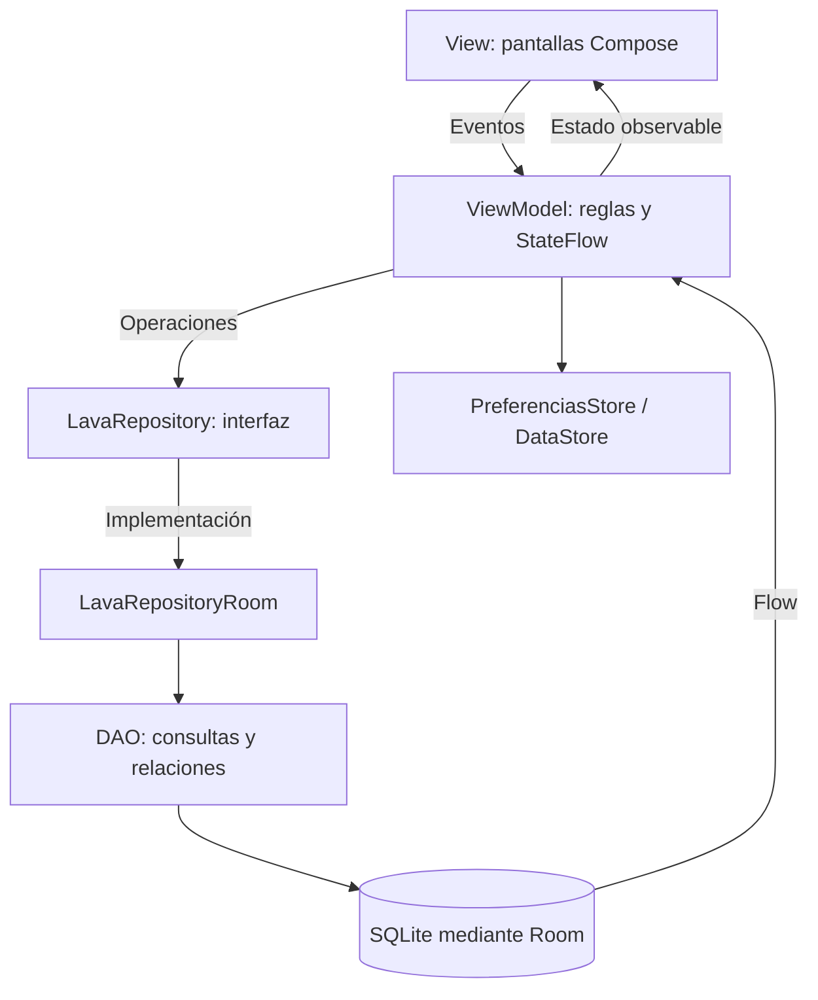
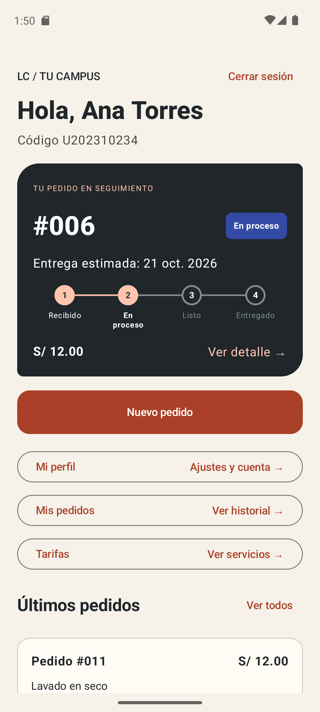
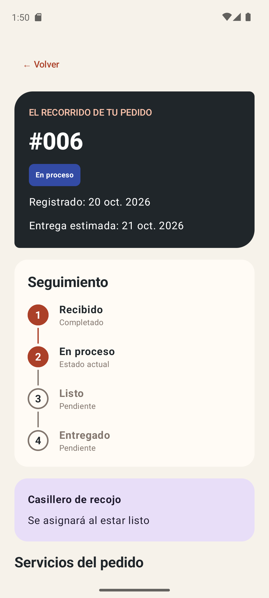
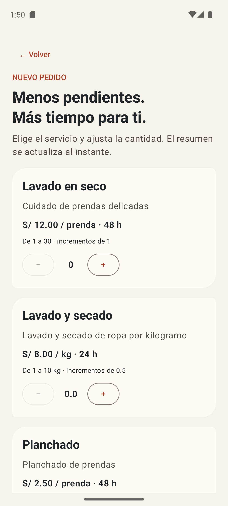
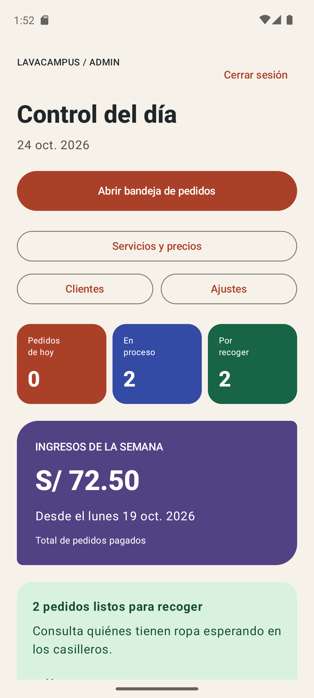
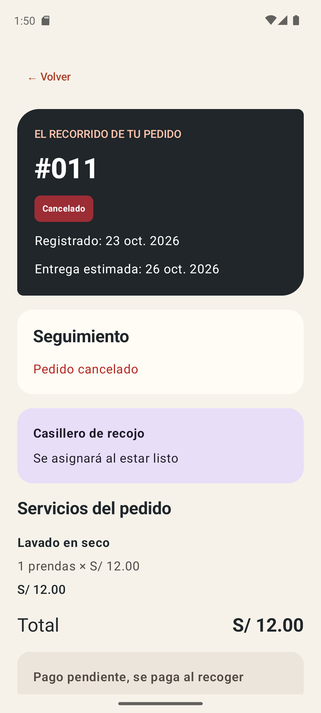
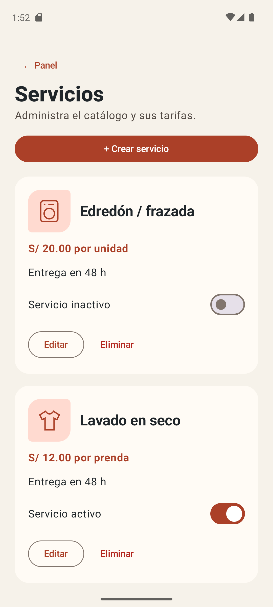

# LavaCampus

> **mejora-ia:** atrasados, descuento por volumen, repetir pedido y diseño Aurora. Ver [rediseño Aurora](docs/REDISENO_AURORA.md), [mejoras](docs/MEJORAS_IA.md), [pruebas](docs/PRUEBAS_IA.md) y [prompts](PROMPTS.md). Las capturas de abajo corresponden a main; genera las nuevas con el modo `-Capturas` del script.


Aplicación Android de lavandería universitaria desarrollada en Kotlin, Jetpack Compose y Material 3, con arquitectura MVVM + Repository, persistencia Room y preferencias DataStore.

**Autor / repositorio:** [JARA20022](https://github.com/JARA20022/Programacion_Moviles_Jara). Proyecto: `Semana08/LavaCampus`. Paquete: `com.jara.lavacampus`.

El estudiante solicita servicios, consulta sus pedidos, sigue el lavado y recoge su ropa en un casillero. El administrador gestiona estados, casilleros, cobros, servicios y clientes. Ambos perfiles usan la misma base local en el dispositivo, como indica el modo práctica del laboratorio.

## Funciones

- Acceso con selector de rol, validación de credenciales, restauración de sesión y cambio de perfil con limpieza de la pila de navegación.
- Pedidos con cantidades por kilo, prenda o unidad; límite de tres activos; cálculo del total y de la entrega, trasladando el domingo al lunes.
- Seguimiento mediante Flow; listas de activos e historial; cancelación conforme al estado.
- Bandeja con búsqueda y filtros; avance RECIBIDO → EN_PROCESO → LISTO → ENTREGADO; casillero libre y cobro previo obligatorios.
- Panel con contadores, ingresos semanales y gráficos Canvas.
- Servicios con validaciones: los usados se pueden desactivar, pero no eliminar. Los importes de pedidos anteriores se conservan.
- Clientes, perfil, modo oscuro, avisos y suspensión de la recepción de pedidos.

## Ejecutar

Abre `Semana08/LavaCampus` en Android Studio y sincroniza Gradle. Conserva las versiones de herramientas y dependencias declaradas en el proyecto. Desde esa carpeta, en PowerShell:

```powershell
.\gradlew.bat :app:assembleDebug
.\gradlew.bat :app:installDebug
```

Para instalar debe haber un emulador o dispositivo conectado. Los datos de ejemplo se cargan una sola vez; reinstalar con `-r` conserva los datos. Desinstalar la app o borrar su almacenamiento elimina la base local.

### Cuentas de práctica

| Perfil | Correo | Clave |
| --- | --- | --- |
| Estudiante — Ana | ana@correo.test | 1234 |
| Estudiante — Luis | luis@correo.test | 1234 |
| Estudiante — Marta | marta@correo.test | 1234 |
| Administrador | admin@lavacampus.test | admin |

Los nombres y correos de estas cuentas son ficticios. `Cambiar de perfil` corresponde al modo práctica local: no representa autenticación contra un servidor. Cada dispositivo conserva su propia base.

## Árbol de paquetes

Archivos Kotlin actuales bajo `app/src/main/java/com/jara/lavacampus`:

- **com.jara.lavacampus/**
    - **data/**
        - **local/**
            - **dao/**
                - `DetalleDao.kt`
                - `PedidoDao.kt`
                - `ServicioDao.kt`
                - `UsuarioDao.kt`
            - **entity/**
                - `DetallePedido.kt`
                - `Pedido.kt`
                - `Servicio.kt`
                - `Usuario.kt`
            - **relation/**
                - `DetalleConServicio.kt`
                - `PedidoConDetalle.kt`
            - `DatosIniciales.kt`
            - `LavaDatabase.kt`
            - `Migraciones.kt`
        - **prefs/**
            - `PreferenciasStore.kt`
        - **repository/**
            - `LavaRepository.kt`
            - `LavaRepositoryRoom.kt`
    - **model/**
        - `Casilleros.kt`
        - `ClienteResumen.kt`
        - `EstadoPedido.kt`
        - `IngresoServicio.kt`
        - `LineaPedido.kt`
        - `PrecioPedido.kt`
        - `RelojCampus.kt`
        - `RepetirPedido.kt`
        - `Rol.kt`
        - `Unidad.kt`
        - `Validaciones.kt`
    - **ui/**
        - **administrador/**
            - `AjustesScreen.kt`
            - `BandejaScreen.kt`
            - `ClientesScreen.kt`
            - `FormularioServicioScreen.kt`
            - `GestionPedidoScreen.kt`
            - `PanelScreen.kt`
            - `ServiciosScreen.kt`
        - **components/**
            - **graficos/**
                - `GraficoBarras.kt`
                - `GraficoDona.kt`
            - `AppTopBar.kt`
            - `EstadoPedidoChip.kt`
            - `IconoServicio.kt`
            - `LavaButton.kt`
            - `LavaTextField.kt`
            - `PedidoCard.kt`
            - `SelectorCantidad.kt`
            - `StepperEstado.kt`
            - `Studio.kt`
        - **estudiante/**
            - `DetallePedidoScreen.kt`
            - `InicioScreen.kt`
            - `LoginScreen.kt`
            - `MisPedidosScreen.kt`
            - `NuevoPedidoScreen.kt`
            - `PerfilScreen.kt`
            - `SplashScreen.kt`
            - `TarifasScreen.kt`
        - **navigation/**
            - `NavLava.kt`
            - `Rutas.kt`
        - **theme/**
            - `Color.kt`
            - `Theme.kt`
            - `Type.kt`
    - **viewmodel/**
        - `BandejaViewModel.kt`
        - `ClientesViewModel.kt`
        - `DetallePedidoViewModel.kt`
        - `GestionPedidoViewModel.kt`
        - `InicioViewModel.kt`
        - `LavaViewModelFactory.kt`
        - `MisPedidosViewModel.kt`
        - `NuevoPedidoViewModel.kt`
        - `PanelViewModel.kt`
        - `ServiciosViewModel.kt`
        - `SesionViewModel.kt`
    - `LavaApp.kt`
    - `MainActivity.kt`

## Arquitectura MVVM



Las pantallas muestran estado y envían eventos; no ejecutan consultas. Los ViewModels aplican reglas y usan la interfaz `LavaRepository`. Su implementación coordina los DAOs y las transacciones. `PreferenciasStore` conserva sesión y ajustes; `NavLava` construye y conecta los ViewModels mediante su factory.

El alta de un pedido y sus detalles es atómica. En la gestión administrativa, la lectura del estado, la comprobación del casillero y la escritura se realizan en una transacción. Las relaciones conectan usuarios, pedidos, detalles y servicios sin copiar sus listas dentro de una entidad.

## Capturas de la fase 1 (main)

Las siguientes imágenes deben capturarse del emulador con la aplicación ejecutándose. No son imágenes de referencia del PDF.

| Estudiante | Administrador |
| --- | --- |
|  |  |
|  |  |
|  |  |

## Pruebas de aceptación

Resultados declarados por quien ejecuta las pruebas en el emulador. Las pruebas no se dan por aprobadas automáticamente por compilar. El procedimiento está en [docs/PRUEBAS.md](docs/PRUEBAS.md) y el registro en [docs/aceptacion.json](docs/aceptacion.json).

| N. | Prueba | Resultado |
| --- | --- | --- |
| 1 | Clave incorrecta: rechaza el acceso | APROBADA |
| 2 | Pedido sin servicios: Confirmar deshabilitado | APROBADA |
| 3 | 3.5 kg + 5 prendas: S/40.50 y fecha correcta | APROBADA |
| 4 | Cuarto pedido activo: rechazado | APROBADA |
| 5 | Estudiante no cancela EN_PROCESO | APROBADA |
| 6 | Listo sin casillero: rechazado | APROBADA |
| 7 | Casillero ocupado: gris y deshabilitado | APROBADA |
| 8 | Entregar exige cobro; cobrado permite entregar | APROBADA |
| 9 | Seguimiento actualiza sin cerrar la pantalla | APROBADA |
| 10 | Ingresos coinciden con pedidos pagados desde el lunes | APROBADA |
| 11 | Servicio usado no se elimina | APROBADA |
| 12 | Pedidos, perfil y modo oscuro persisten al reabrir | APROBADA |

## Para pensar

El paso 14 menciona respuestas de «Para pensar», pero en el PDF recibido no se identifica una lista con ese título. Se responden las preguntas explícitas que sí aparecen en la guía; no se atribuyen al docente preguntas adicionales.

### ¿Por qué un pedido tiene detalles en otra tabla? — página 4

Un pedido puede incluir varios servicios con cantidades y precios diferentes. La relación uno a muchos permite guardar una fila por línea, vinculada al pedido mediante una clave foránea. Así se evitan columnas repetidas y se pueden consultar servicios, subtotales e ingresos mediante JOIN y agregaciones.

### ¿Por qué guardar precioUnitario y subtotal en el detalle? — página 4

Representan lo acordado al registrar el pedido. Si después cambia la tarifa del servicio, el pedido anterior conserva su importe. Calcularlo siempre con el precio vigente alteraría el historial y los ingresos registrados.

### ¿Esta función cambia datos una sola vez o debe avisar cuando cambian? — página 15

Crear un pedido es una operación puntual: se declara `suspend`, devuelve el identificador y agrupa cabecera y detalles en una transacción. Observar los pedidos requiere emisiones posteriores cuando la base cambia: el DAO devuelve `Flow` y el ViewModel expone `StateFlow` para actualizar la pantalla.

## Entrega por ramas

- `main`: implementación base, pasos 0 al 14 del laboratorio, con commits por etapa.
- `mejora-ia`: fase siguiente, con un mínimo de tres mejoras y `PROMPTS.md`. No queda completada por terminar este README.

Las capturas de la fase 1 muestran crema, terracota y carbón. En mejora-ia la edición Aurora utiliza violeta y coral, navegación inferior y una composición nueva; conserva la funcionalidad y estructura del laboratorio.


## Revisión contra la guía

Ver [auditoría S08](docs/AUDITORIA_S08.md): requisitos, correcciones de navegación/contraste, alcance y verificaciones manuales pendientes.
