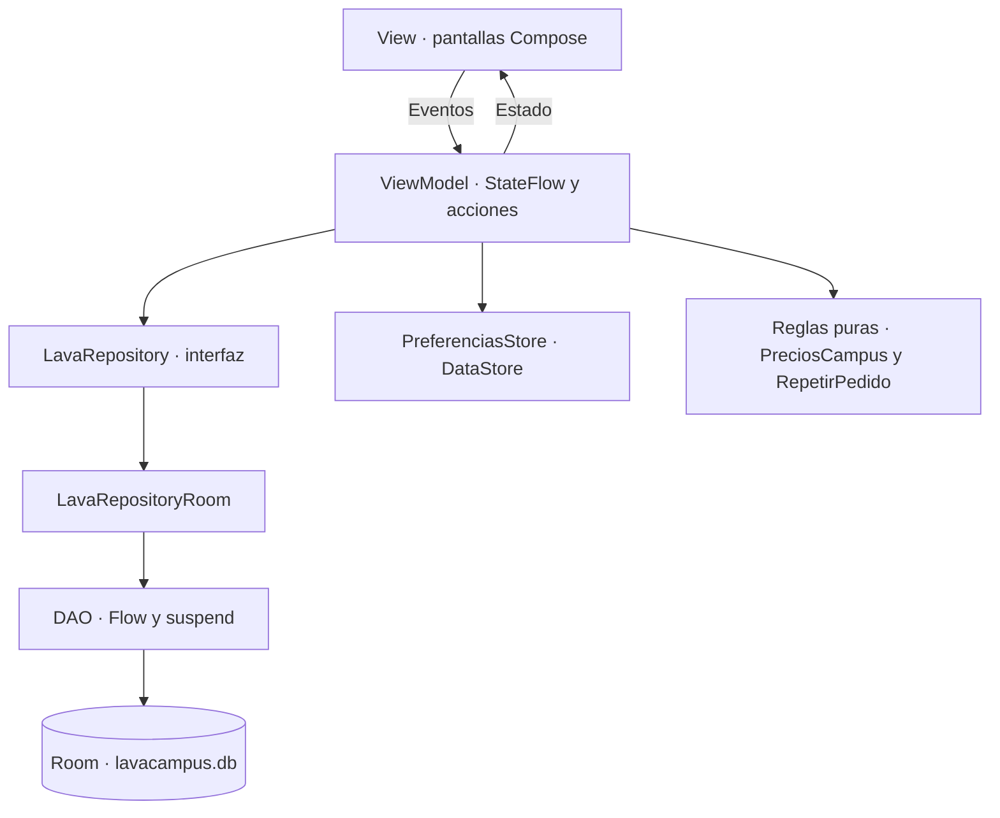

# LavaCampus · mejora-ia

Aplicación Android para la lavandería de un campus universitario. Esta rama amplía la versión base con **pedidos atrasados, descuento por volumen y repetición de pedidos**, y añade el diseño **Aurora** con Kotlin, Jetpack Compose y Material 3.

| Dato | Valor |
|---|---|
| Proyecto | LavaCampus · Semana 08 |
| Autor | Iván Jara Ayala · [JARA20022](https://github.com/JARA20022) |
| Carpeta | `Semana08/LavaCampus` |
| Rama documentada | `mejora-ia` |
| Código contrastado | `fa51c56` · revisión documental del 30/10/2026 |
| Paquete / applicationId | `com.jara.lavacampus` |
| Arquitectura | MVVM + Repository mediante interfaz |
| Persistencia | Room y DataStore; funcionamiento local |
| Asistencia de IA | ChatGPT; instrucciones ampliadas para un agente en Android Studio en [PROMPTS.md](PROMPTS.md) |

## Contenido

- [Qué añade esta rama](#qué-añade-esta-rama)
- [Reglas y validaciones](#reglas-y-validaciones)
- [Diseño Aurora](#diseño-aurora)
- [Arquitectura](#arquitectura)
- [Estructura](#estructura)
- [Room y migración](#room-y-migración)
- [Ejecutar](#ejecutar)
- [Pruebas y evidencias](#pruebas-y-evidencias)
- [Historial y documentación](#historial-y-documentación)

## Qué añade esta rama

La base incluye acceso por rol, servicios, creación de pedidos, seguimiento de estados, casilleros, cobros, panel administrativo, clientes y preferencias. Los perfiles Estudiante y Administrador comparten la base Room del mismo dispositivo; no se necesita un servidor para esta práctica.

### 1. Pedidos atrasados

La bandeja identifica pedidos con `fechaEntrega < hoy` cuyo estado no sea `ENTREGADO` ni `CANCELADO`.

- Marca los atrasados con un aviso y tratamiento visual de alerta.
- Ofrece el filtro **Atrasados**.
- El panel muestra su cantidad y permite abrir la bandeja filtrada.
- `RelojCampus` emite la fecha local y comprueba el cambio de día cada minuto mientras se observa el flujo.
- Room entrega los cambios como `Flow`; los ViewModels los exponen como `StateFlow`.

**Recorrido:** `PedidoDao` → `LavaRepository` → `LavaRepositoryRoom` → `BandejaViewModel` / `PanelViewModel` → pantallas.

### 2. Descuento por volumen

Si la suma de las cantidades de los servicios cobrados por **KG supera 5 kg**, se aplica un **10 % de descuento a esas líneas por KG**. Las líneas por prenda o unidad conservan su importe.

- Exactamente 5 kg no activa el descuento.
- Se muestra subtotal, ahorro y total antes de confirmar.
- Se calculan importes monetarios con `BigDecimal` y redondeo `HALF_UP` a dos decimales.
- El Repository vuelve a calcular con los servicios actuales dentro de la transacción de guardado.
- Se guardan los importes para conservar el historial.

| Selección | Subtotal | Descuento | Total |
|---|---:|---:|---:|
| 3.5 kg a S/8 + 5 prendas a S/2.50 | S/40.50 | S/0.00 | **S/40.50** |
| 5 kg a S/8 | S/40.00 | S/0.00 | **S/40.00** |
| 5.5 kg a S/8 | S/44.00 | S/4.40 | **S/39.60** |
| 6 kg a S/8 + 5 prendas a S/2.50 | S/60.50 | S/4.80 | **S/55.70** |

El descuento se calcula en `model/PrecioPedido.kt`. El precio unitario original queda guardado en cada detalle; el subtotal del detalle nuevo representa el importe neto, y su descuento se almacena aparte. Así, los ingresos por servicio pueden sumar los importes netos cobrados.

### 3. Repetir un pedido

Desde **Mis pedidos → Historial → Pedir de nuevo**, se abre Nuevo pedido con un borrador editable.

- Solo se repiten pedidos propios en estado `ENTREGADO` o `CANCELADO`.
- Se recuperan servicios y cantidades del pedido anterior.
- Se utilizan **precios actuales**, sin copiar el precio histórico como tarifa vigente.
- Se omiten servicios inexistentes, inactivos o con cantidades incompatibles; se informa al usuario.
- Se conserva la nota solo si continúa siendo válida.
- No se inserta nada al tocar el botón: el estudiante debe revisar y confirmar.
- Siguen vigentes el límite de tres pedidos activos y la disponibilidad de recepción.

La preparación del borrador está en `model/RepetirPedido.kt`; `NuevoPedidoViewModel` coordina su carga y recalcula el resumen.

## Reglas y validaciones

Las validaciones de la versión base se conservan; no se presentan como funciones nuevas exclusivas de la IA.

| Área | Comportamiento |
|---|---|
| Acceso | Correo con formato válido, límites de longitud, clave obligatoria y rol coincidente con la cuenta. |
| Nombre del servicio | Letras Unicode y tildes, separadores permitidos, al menos tres letras y máximo 60 caracteres; comparación normalizada para evitar duplicados. |
| Precio | S/0.01–S/9999.99 y hasta dos decimales; se admite punto o coma en la entrada. Se rechazan signos, exponentes y valores no finitos. |
| Descripción y nota | Máximo 300 caracteres; se rechazan controles no permitidos y caracteres de formato invisibles. |
| Cantidades KG | De 1 a 10 kg, pasos de 0.5; cero desactiva la línea. |
| Prenda o unidad | Cantidades enteras de 1 a 30. |
| Pedido | Solo servicios activos, líneas sin duplicados y máximo tres pedidos activos por estudiante. |
| Entrega | Se toma el mayor tiempo del servicio; si la fecha cae domingo, pasa al lunes. |
| Estados | `RECIBIDO` → `EN_PROCESO` → `LISTO` → `ENTREGADO`; no se retrocede. `CANCELADO` es final. |
| Casillero | Para marcar Listo se exige uno libre entre C-01 y C-30. |
| Cobro | Entregar requiere que el pedido esté pagado. |
| Cancelación | Estudiante: solo Recibido. Administrador: Recibido o En proceso. |
| Servicios usados | No se eliminan si aparecen en detalles; se pueden desactivar. |
| Repetición | Se verifica propietario, estado, catálogo vigente, cantidades y tarifas. |

`Validaciones.kt` concentra comprobaciones compartidas. Los ViewModels controlan las acciones y la implementación Room revalida el alta y los importes al persistir. Las pantallas muestran estado y envían eventos.

## Diseño Aurora

Aurora reemplaza la primera propuesta visual de esta fase. Cambia la composición del login, el inicio del estudiante, el panel y el formulario de pedido; incorpora tarjetas redondeadas, accesos en cuadrícula, navegación por rol y una barra de total/confirmación en Nuevo pedido.

### Paleta oscura

Valores definidos en `ui/theme/Theme.kt`:

| Token | Color | Uso |
|---|---|---|
| `background` | `#101018` | Fondo principal |
| `onBackground` | `#F5F0FF` | Texto que corresponde al fondo oscuro |
| `surface` / `onSurface` | `#20202E` / `#F5F0FF` | Tarjetas y su texto |
| `surfaceVariant` / `onSurfaceVariant` | `#2A293C` / `#C0B9CE` | Superficies de apoyo y texto secundario |
| `primary` / `onPrimary` | `#C4AEFF` / `#27124F` | Acento violeta y contraste |
| `primaryContainer` / `onPrimaryContainer` | `#392B59` / `#EBE0FF` | Módulos y selección |
| `secondary` / `onSecondary` | `#FFB49F` / `#4B2319` | Acento coral |
| `secondaryContainer` / `onSecondaryContainer` | `#4F302A` / `#FFDFD5` | Módulos alternativos |
| `tertiary` / `onTertiary` | `#8FDCC8` / `#00382F` | Información de ahorro |
| `outline` / `outlineVariant` | `#91869F` / `#40394F` | Contornos |
| `error` / `onError` | `#FFA8B8` / `#5C1427` | Error legible |
| `errorContainer` / `onErrorContainer` | `#482631` / `#FFDDE5` | Avisos de atención |

### Paleta clara

| Token | Color |
|---|---|
| `background` / `onBackground` | `#F4F1FA` / `#211B30` |
| `surface` / `onSurface` | `#FFFBFF` / `#211B30` |
| `surfaceVariant` / `onSurfaceVariant` | `#EAE4F3` / `#625A70` |
| `primary` / `onPrimary` | `#6841C6` / `#FFFFFF` |
| `primaryContainer` / `onPrimaryContainer` | `#E7DEFF` / `#2B1757` |
| `secondary` / `onSecondary` | `#9C462E` / `#FFFFFF` |
| `secondaryContainer` / `onSecondaryContainer` | `#FFDAD0` / `#451B13` |
| `tertiary` / `onTertiary` | `#006A60` / `#FFFFFF` |
| `outline` / `outlineVariant` | `#81768E` / `#DBD2E9` |
| `error` / `onError` | `#AA2C3D` / `#FFFFFF` |
| `errorContainer` / `onErrorContainer` | `#FFDADF` / `#5F1424` |

Se utilizan también los colores de marca `#171324`, `#7046D2`, `#6452C6`, `#E0D5FF` y `#FFB49F`. La tarjeta de ingresos combina `#E3D9FF` y `#C1A4FC`, con texto oscuro `#281843`.

### Tipografía, formas y movimiento

| Elemento | Configuración |
|---|---|
| Tipografía | `FontFamily.SansSerif` |
| Importe destacado | 42 sp / 46 sp, ExtraBold, espaciado −1.5 sp |
| Título principal | 34 sp / 39 sp, Bold |
| Título de sección | 28 sp / 34 sp o 24 sp / 30 sp |
| Cuerpo | 16 sp / 24 sp y 14 sp / 21 sp |
| Texto auxiliar | 12 sp / 18 sp |
| Esquinas del tema | 10, 16, 24, 30 y 36 dp |
| Entrada de bloques | Opacidad y desplazamiento vertical durante 420 ms; retraso escalonado de hasta 260 ms |
| Motivo orbital | Canvas con animación inicial de 900 ms |
| Cambio de pantalla | Entrada con fundido de 260 ms y desplazamiento de 280 ms; salida de 160 ms |
| Pulsación del botón | Escala aproximada 0.97 con respuesta de resorte |
| Textura | Grano sutil calculado en `drawWithCache`, sin recrear puntos en cada fotograma |

El modo oscuro se activa una vez al estrenar esta edición; después se conserva la elección hecha en Perfil o Ajustes. Los componentes principales de la composición están en `ui/components/Studio.kt`.

**Revisión S08 integrada en el código:** la navegación tiene cuatro destinos de estudiante y cinco de administrador, incluido Clientes. Se define `contentColor = MaterialTheme.colorScheme.onBackground` en los contenedores para corregir los títulos del tema oscuro, y la cancelación del estudiante se revalida dentro de una transacción. La comprobación visual en el dispositivo y las capturas siguen siendo evidencias independientes de estas correcciones de código.

## Arquitectura



- **View:** no consulta DAOs ni ejecuta SQL; muestra estado y comunica acciones.
- **ViewModel:** depende del contrato `LavaRepository`, coordina la operación y expone estado observable.
- **Repository:** su implementación usa Room y transacciones para persistir los cambios.
- **DAO:** contiene consultas y acciones sobre las tablas.
- **Model:** agrupa tipos y reglas de cálculo/preparación que se pueden probar separadamente.
- **DataStore:** guarda sesión y preferencias; los pedidos permanecen en Room.

## Estructura

- **com.jara.lavacampus/**
    - **data/**
        - **local/**
            - **dao/**
                - `DetalleDao.kt`
                - `PedidoDao.kt`
                - `ServicioDao.kt`
                - `UsuarioDao.kt`
            - **entity/**
                - `DetallePedido.kt`
                - `Pedido.kt`
                - `Servicio.kt`
                - `Usuario.kt`
            - **relation/**
                - `DetalleConServicio.kt`
                - `PedidoConDetalle.kt`
            - `DatosIniciales.kt`
            - `LavaDatabase.kt`
            - `Migraciones.kt`
        - **prefs/**
            - `PreferenciasStore.kt`
        - **repository/**
            - `LavaRepository.kt`
            - `LavaRepositoryRoom.kt`
    - **model/**
        - `Casilleros.kt`
        - `ClienteResumen.kt`
        - `EstadoPedido.kt`
        - `IngresoServicio.kt`
        - `LineaPedido.kt`
        - `PrecioPedido.kt`
        - `RelojCampus.kt`
        - `RepetirPedido.kt`
        - `Rol.kt`
        - `Unidad.kt`
        - `Validaciones.kt`
    - **ui/**
        - **administrador/**
            - `AjustesScreen.kt`
            - `BandejaScreen.kt`
            - `ClientesScreen.kt`
            - `FormularioServicioScreen.kt`
            - `GestionPedidoScreen.kt`
            - `PanelScreen.kt`
            - `ServiciosScreen.kt`
        - **components/**
            - **graficos/**
                - `GraficoBarras.kt`
                - `GraficoDona.kt`
            - `AppTopBar.kt`
            - `EstadoPedidoChip.kt`
            - `IconoServicio.kt`
            - `LavaButton.kt`
            - `LavaTextField.kt`
            - `PedidoCard.kt`
            - `SelectorCantidad.kt`
            - `StepperEstado.kt`
            - `Studio.kt`
        - **estudiante/**
            - `DetallePedidoScreen.kt`
            - `InicioScreen.kt`
            - `LoginScreen.kt`
            - `MisPedidosScreen.kt`
            - `NuevoPedidoScreen.kt`
            - `PerfilScreen.kt`
            - `SplashScreen.kt`
            - `TarifasScreen.kt`
        - **navigation/**
            - `NavLava.kt`
            - `Rutas.kt`
        - **theme/**
            - `Color.kt`
            - `Theme.kt`
            - `Type.kt`
    - **viewmodel/**
        - `BandejaViewModel.kt`
        - `ClientesViewModel.kt`
        - `DetallePedidoViewModel.kt`
        - `GestionPedidoViewModel.kt`
        - `InicioViewModel.kt`
        - `LavaViewModelFactory.kt`
        - `MisPedidosViewModel.kt`
        - `NuevoPedidoViewModel.kt`
        - `PanelViewModel.kt`
        - `ServiciosViewModel.kt`
        - `SesionViewModel.kt`
    - `LavaApp.kt`
    - `MainActivity.kt`

`AppTopBar.kt` y `SplashScreen.kt` están implementados como componentes independientes y se utilizan desde el detalle del pedido y la navegación, respectivamente. La revisión S08 también completa la barra inferior: Inicio, Pedidos, Tarifas y Perfil para estudiante; Panel, Pedidos, Servicios, Clientes y Ajustes para administrador.

## Room y migración

Tablas: `usuarios`, `servicios`, `pedidos` y `detalles_pedido`. En esta rama `LavaDatabase` usa **versión 2** y registra `MIGRACION_1_2`.

| Cambio | Tratamiento de los datos anteriores |
|---|---|
| `pedidos.descuento` | Se agrega con valor predeterminado 0. |
| `pedidos.subtotal` | Se agrega y se rellena con el total anterior. |
| `detalles_pedido.descuento` | Se agrega con valor predeterminado 0. |

No se recalcula retroactivamente el descuento ni se cambian los totales históricos. La migración no borra tablas ni utiliza una recreación destructiva como sustituto del cambio de esquema.

Para comparar la APK de `main` (base v1) con esta rama (v2), utiliza instalaciones de prueba en emuladores distintos. La APK v1 no tiene una migración de retorno para abrir una base v2.

## Ejecutar

### Herramientas declaradas en el proyecto

| Herramienta | Versión / configuración |
|---|---|
| Gradle Wrapper | 9.4.1 |
| JDK del daemon | 21, declarado en `gradle-daemon-jvm.properties` |
| Android Gradle Plugin | 9.2.1 |
| Kotlin / plugin Compose | 2.2.10 |
| KSP | 2.3.12 |
| Compose BOM | 2024.09.00 |
| Room | 2.8.5 |
| Navigation Compose | 2.8.3 |
| Lifecycle | 2.8.6 |
| DataStore | 1.1.1 |
| SDK | compileSdk 36.1, targetSdk 36, minSdk 26 |

Conserva las versiones del repositorio y configura el SDK/JDK compatible en Android Studio. Abre `Semana08/LavaCampus`, sincroniza y utiliza el wrapper del proyecto.

```powershell
Set-Location "C:\Users\tuoga\OneDrive\Desktop\Programacion_Moviles_Jara\Semana08\LavaCampus"
git switch mejora-ia
.\gradlew.bat :app:testDebugUnitTest :app:assembleDebug :app:assembleDebugAndroidTest
```

Para instalar la aplicación debe haber un dispositivo listo o un emulador iniciado:

```powershell
.\gradlew.bat :app:installDebug
```

### Cuentas ficticias de práctica

| Perfil | Correo | Clave |
|---|---|---|
| Estudiante · Ana | ana@correo.test | 1234 |
| Estudiante · Luis | luis@correo.test | 1234 |
| Estudiante · Marta | marta@correo.test | 1234 |
| Administrador | admin@lavacampus.test | admin |

Los datos se siembran una vez. Cada dispositivo tiene su propia base local. Cambiar de perfil pertenece al modo de práctica del laboratorio.

## Pruebas y evidencias

La suite incluye pruebas de `ValidacionesTest`, `PreciosCampusTest`, `RepetirPedidoTest` y la prueba de plantilla del proyecto. Existe una prueba instrumentada de migración en `MigracionCampusTest`, que utiliza una base temporal de prueba.

| Verificación | Fuente / estado |
|---|---|
| Pruebas unitarias y compilación | Ejecutar el comando de Gradle anterior; no se certifican por editar este README. |
| Migración en un dispositivo | Ejecutar el APK de pruebas y revisar el resultado de `MigracionCampusTest`. |
| Reglas funcionales de las mejoras | Casos y resultados en [docs/PRUEBAS_IA.md](docs/PRUEBAS_IA.md); actualmente figuran pendientes. |
| Regresión de la base | Repetir los doce casos de [docs/PRUEBAS.md](docs/PRUEBAS.md). |
| Diseño, teclado y accesibilidad | Revisar ambos temas, tamaño de letra, desplazamiento y navegación. |
| Evidencias Aurora | Capturas propias de mejora-ia pendientes de incorporar. |

### Capturas que se deben obtener de mejora-ia

| Pantalla | Debe permitir comprobar |
|---|---|
| Login | Selector de rol, campos y composición Aurora. |
| Inicio del estudiante | Acción de nuevo pedido y seguimiento. |
| Resumen con descuento | 6 kg + 5 prendas: S/60.50 − S/4.80 = S/55.70. |
| Historial / borrador repetido | Botón Pedir de nuevo y carga con tarifas vigentes. |
| Bandeja de atrasados | Marca de alerta y filtro aplicado. |
| Panel administrativo | Contador de atrasados, ingresos y accesos. |

No se incluyen enlaces a imágenes que todavía no existen. Cuando se capturen, pueden guardarse en `docs/capturas-ia/` y enlazarse desde este apartado.

<details>
<summary>Referencia visual de la fase 1: capturas existentes de main</summary>

Estas imágenes ya forman parte del repositorio y muestran la versión base. No se presentan como capturas del diseño Aurora.

| Estudiante | Administrador |
|---|---|
|  |  |
|  |  |
|  |  |

</details>

## Historial y documentación

La fase 2 parte de `main`. Su historial de entrega contiene las mejoras A, B y C, el diseño Aurora y el commit D de documentación. La corrección anterior del origen de la rama quedó documentada en [docs/REPARACION_GIT.md](docs/REPARACION_GIT.md), con respaldo del historial precedente.

| Documento | Contenido |
|---|---|
| [PROMPTS.md](PROMPTS.md) | Cinco prompts técnicos ampliados, mensajes reales de cambio, resultados, correcciones y explicación de MVVM. |
| [docs/MEJORAS_IA.md](docs/MEJORAS_IA.md) | Detalle funcional de las tres mejoras y de la persistencia. |
| [docs/PRUEBAS_IA.md](docs/PRUEBAS_IA.md) | Casos de aceptación de esta fase. |
| [docs/REDISENO_AURORA.md](docs/REDISENO_AURORA.md) | Alcance de la propuesta visual. |
| [docs/REPARACION_GIT.md](docs/REPARACION_GIT.md) | Procedencia y reorganización transparente de las ramas. |
| [docs/AUDITORIA_S08.md](docs/AUDITORIA_S08.md) | Matriz de requisitos, navegación 4/5, cancelación y revisión de contraste. |

Esta actualización modifica únicamente `README.md` y `PROMPTS.md` de `mejora-ia`. La documentación de `main` se trabaja por separado.


## Referencias técnicas

- [Persistencia local con Room · Android Developers](https://developer.android.com/training/data-storage/room?hl=es-419).
- [Migraciones de Room · Android Developers](https://developer.android.com/training/data-storage/room/migrating-db-versions).
