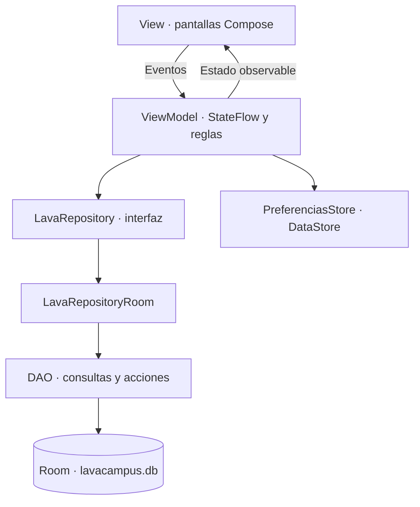

# LavaCampus · rama main

Aplicación Android para gestionar los servicios de una lavandería universitaria. El estudiante registra sus pedidos y sigue el estado de su ropa; el administrador organiza el lavado, asigna casilleros, registra cobros y administra el catálogo.

Esta rama contiene la **implementación base de la fase 1 del laboratorio S08**, desarrollada en Kotlin y Jetpack Compose, con persistencia local mediante Room y preferencias con DataStore.

| Dato | Valor |
|---|---|
| Autor | Iván Jara Ayala · [JARA20022](https://github.com/JARA20022) |
| Repositorio | [Programacion_Moviles_Jara](https://github.com/JARA20022/Programacion_Moviles_Jara) |
| Proyecto | `Semana08/LavaCampus` |
| Rama | `main` |
| Paquete / applicationId | `com.jara.lavacampus` |
| Arquitectura | MVVM + Repository mediante interfaz |
| Base de datos | `lavacampus.db`, versión 1 |
| Modalidad | Práctica local, con dos perfiles en un mismo dispositivo |

## Contenido

- [Requerimientos](#requerimientos)
- [Instalación y ejecución](#instalación-y-ejecución)
- [Funciones por perfil](#funciones-por-perfil)
- [Reglas de negocio](#reglas-de-negocio)
- [Arquitectura](#arquitectura)
- [Modelo de datos](#modelo-de-datos)
- [Estructura del proyecto](#estructura-del-proyecto)
- [Interfaz y navegación](#interfaz-y-navegación)
- [Pruebas y verificación](#pruebas-y-verificación)
- [Capturas](#capturas)
- [Para pensar](#para-pensar)
- [Organización por ramas](#organización-por-ramas)

## Requerimientos

### Entorno de desarrollo

| Requisito | Configuración del proyecto |
|---|---|
| Android Studio | Instalación compatible con Android Gradle Plugin 9.2.1 |
| JDK del daemon de Gradle | Java 21, declarado en `gradle/gradle-daemon-jvm.properties` |
| Gradle | Wrapper 9.4.1 incluido en el repositorio |
| Android SDK de compilación | API 36.1 |
| SDK objetivo | API 36 |
| Android mínimo para instalar | API 26 · Android 8.0 |
| Control de versiones | Git y acceso al repositorio para publicar cambios |
| Ejecución de la app | Emulador iniciado o dispositivo Android con depuración USB |
| Conexión durante la preparación | Necesaria para descargar SDK, distribución de Gradle y dependencias |

Las versiones se toman de los archivos del proyecto. Se utiliza `gradlew.bat`; no hace falta instalar otra distribución de Gradle manualmente. Las dependencias pueden descargarse al sincronizar por primera vez.

### Tecnologías y dependencias principales

| Tecnología | Versión / uso |
|---|---|
| Kotlin y plugin Compose | 2.2.10 |
| Android Gradle Plugin | 9.2.1 |
| KSP | 2.3.12 |
| Compose BOM | 2024.09.00 |
| Jetpack Compose + Material 3 | Interfaz declarativa |
| Activity Compose | 1.9.2 |
| Lifecycle | 2.8.6, ViewModels y observación del estado |
| Navigation Compose | 2.8.3 |
| Room | 2.8.5, SQLite local, entidades, relaciones, DAO y transacciones |
| DataStore Preferences | 1.1.1, sesión y ajustes |
| Kotlin Coroutines / Flow | Trabajo asíncrono y datos reactivos |
| JUnit | 4.13.2, pruebas unitarias |

La interfaz se implementa con Compose. Los archivos Android de configuración y recursos del proyecto no sustituyen las pantallas por diseños XML.

## Instalación y ejecución

### Abrir el proyecto existente

En PowerShell:

```powershell
Set-Location "C:\Users\tuoga\OneDrive\Desktop\Programacion_Moviles_Jara\Semana08\LavaCampus"
git switch main
git status
```

Abre esa carpeta en Android Studio, configura el JDK/SDK y sincroniza Gradle. `local.properties` identifica la ubicación del SDK en cada equipo; no debe copiarse como configuración universal entre computadoras.

### Compilar y ejecutar pruebas unitarias

```powershell
.\gradlew.bat :app:testDebugUnitTest :app:assembleDebug
```

El APK de desarrollo se genera en:

```text
app/build/outputs/apk/debug/app-debug.apk
```

### Instalar en el emulador o teléfono

Inicia un emulador desde Device Manager o conecta un dispositivo con depuración USB autorizada. Después ejecuta:

```powershell
.\gradlew.bat :app:installDebug
```

Abre LavaCampus en el dispositivo. También puedes ejecutarla desde Android Studio seleccionando la configuración `app` y el dispositivo conectado.

Si la instalación muestra `No connected devices!`, falta un dispositivo disponible para ADB; la compilación del APK y su instalación son operaciones diferentes.

### Cuentas ficticias incluidas

| Perfil | Correo | Contraseña |
|---|---|---|
| Estudiante · Ana Torres | ana@correo.test | 1234 |
| Estudiante · Luis Ramos | luis@correo.test | 1234 |
| Estudiante · Marta Flores | marta@correo.test | 1234 |
| Administrador | admin@lavacampus.test | admin |

Los datos se cargan una sola vez al crear la base. Incluyen cuatro servicios y diez pedidos de ejemplo, con estados y fechas calculados para la práctica. No se requiere registro de cuentas para utilizar los perfiles proporcionados.

Ambos perfiles comparten la misma base en el dispositivo. No hay sincronización entre teléfonos ni autenticación contra un backend en esta fase. La app puede utilizarse localmente después de instalarla.

## Funciones por perfil

### Estudiante

- Iniciar sesión con selector de rol y recuperar la sesión guardada.
- Consultar el pedido activo más reciente y los dos últimos pedidos.
- Crear un pedido con varios servicios, cantidades, nota, total y entrega estimada.
- Seguir los estados con un indicador Canvas horizontal o vertical.
- Consultar casillero, detalle de servicios, importes históricos y estado del pago.
- Cancelar pedidos que todavía estén en Recibido, mediante confirmación.
- Separar los pedidos en Activos e Historial.
- Consultar tarifas de servicios activos y tiempos de entrega.
- Consultar datos de perfil, pedidos activos/totales y kilos de pedidos entregados.
- Cambiar modo oscuro y avisos, cambiar de perfil o cerrar sesión.

### Administrador

- Consultar pedidos de hoy, pedidos en proceso y pedidos por recoger.
- Revisar ingresos desde el lunes y gráficos Canvas por estado y servicio.
- Abrir la alerta de pedidos listos que esperan recojo.
- Buscar pedidos por estudiante o número y filtrarlos por estado.
- Iniciar lavado, marcar Listo y registrar la entrega respetando el flujo.
- Elegir un casillero libre, registrar el cobro y cancelar cuando corresponda.
- Crear, editar, activar, desactivar y eliminar servicios que no estén utilizados.
- Consultar clientes, número de pedidos no cancelados e importe pagado.
- Cambiar preferencias, habilitar o suspender la recepción de pedidos y cambiar de perfil.

## Reglas de negocio

| Área | Regla implementada |
|---|---|
| Visibilidad | El estudiante consulta sus pedidos; el administrador gestiona todos. |
| Cantidades por kilo | Entre 1 y 10 kg, en pasos de 0.5; cero desactiva la línea. |
| Prenda o unidad | Cantidades enteras entre 1 y 30. |
| Servicios disponibles | Solo los activos se ofrecen para nuevos pedidos. |
| Límite | Máximo tres pedidos activos por estudiante: Recibido, En proceso o Listo. |
| Importe | Cada subtotal se obtiene de cantidad × precio; el total suma los subtotales. |
| Precio histórico | El detalle guarda precio unitario y subtotal; cambiar una tarifa no modifica pedidos anteriores. |
| Entrega | Se usa el mayor tiempo de los servicios; si la fecha calculada cae domingo, pasa al lunes. |
| Alta | Pedido y detalles se guardan en una misma transacción. |
| Estado inicial | Recibido y pago pendiente. |
| Flujo | Recibido → En proceso → Listo → Entregado; sin retrocesos. Cancelado es final. |
| Cancelación del estudiante | Solo desde Recibido; la revalidación y la escritura se realizan en una transacción. |
| Cancelación administrativa | Solo desde Recibido o En proceso. |
| Marcar Listo | Requiere un casillero libre con formato C-01 a C-30. |
| Entregar | Requiere que el pedido esté cobrado. |
| Eliminar servicio | Se rechaza si aparece en detalles; desactivarlo sí está permitido. |
| Recibir pedidos | Si se deshabilita, el estudiante no puede confirmar nuevas solicitudes. |
| Preferencias | Perfil, tema y ajustes se conservan en DataStore al reabrir la app. |

### Validaciones de entrada

- Nombres con letras Unicode y tildes, separadores permitidos, mínimo tres letras y máximo 60 caracteres.
- Normalización de nombres para detectar servicios duplicados.
- Precio de S/0.01 a S/9999.99, con hasta dos decimales y entrada con punto o coma.
- Rechazo de precios negativos, texto arbitrario, exponentes, NaN y valores infinitos.
- Notas y descripciones de hasta 300 caracteres, sin controles no permitidos ni formato invisible.
- Correo con formato válido, credenciales obligatorias y coincidencia del rol seleccionado.
- Cantidades válidas para la unidad y líneas sin servicios repetidos.
- Estados de carga/guardado y controles de acciones para evitar confirmaciones repetidas.

### Ejemplo de cálculo de la versión base

| Servicio | Cantidad | Precio | Subtotal |
|---|---:|---:|---:|
| Lavado y secado | 3.5 kg | S/8.00 | S/28.00 |
| Planchado | 5 prendas | S/2.50 | S/12.50 |
| **Total** | | | **S/40.50** |

La entrega se calcula con las 48 horas del servicio más lento. Si el día resultante es domingo, se traslada al lunes.

## Arquitectura



| Capa | Responsabilidad |
|---|---|
| View | Presentar estado, mostrar errores y enviar eventos al ViewModel. |
| ViewModel | Coordinar operaciones, aplicar reglas y exponer estado de pantalla. |
| Repository | Definir el contrato; su implementación conecta los DAOs y las transacciones. |
| DAO | Ejecutar consultas y acciones de persistencia con Room. |
| Model | Tipos, estados, unidades, casilleros y validaciones compartidas. |
| DataStore | Conservar sesión y preferencias pequeñas. |

Las lecturas que deben reaccionar a cambios usan `Flow`; las acciones puntuales se declaran `suspend`. `LavaViewModelFactory` conecta las dependencias con los ViewModels. `LavaApp` inicializa la base y coordina la carga de datos mediante corrutinas en IO.

## Modelo de datos

| Tabla | Información | Relaciones |
|---|---|---|
| `usuarios` | Nombre, código, correo, clave ficticia y rol | Un usuario tiene varios pedidos. |
| `servicios` | Nombre, descripción, unidad, precio, tiempo, activo e icono | Un servicio puede aparecer en varios detalles. |
| `pedidos` | Usuario, fechas, estado, total, casillero, pago y nota | Pertenece a un usuario y tiene varios detalles. |
| `detalles_pedido` | Servicio, cantidad, precio unitario y subtotal | Pertenece a un pedido y referencia un servicio. |

Las claves primarias se autogeneran. Las claves foráneas y sus índices mantienen las relaciones. Al eliminar un pedido, sus detalles tienen eliminación en cascada. `PedidoConDetalle` y `DetalleConServicio` representan las relaciones anidadas mediante `@Embedded` y `@Relation`.

Room utiliza una instancia singleton de `LavaDatabase`. La siembra se realiza en una transacción cuando todavía no hay usuarios. Los pedidos y servicios permanecen en Room; DataStore no se usa como almacén de pedidos.

## Estructura del proyecto

- **com.jara.lavacampus/**
    - **data/**
        - **local/**
            - **dao/**
                - `DetalleDao.kt`
                - `PedidoDao.kt`
                - `ServicioDao.kt`
                - `UsuarioDao.kt`
            - **entity/**
                - `DetallePedido.kt`
                - `Pedido.kt`
                - `Servicio.kt`
                - `Usuario.kt`
            - **relation/**
                - `DetalleConServicio.kt`
                - `PedidoConDetalle.kt`
            - `DatosIniciales.kt`
            - `LavaDatabase.kt`
        - **prefs/**
            - `PreferenciasStore.kt`
        - **repository/**
            - `LavaRepository.kt`
            - `LavaRepositoryRoom.kt`
    - **model/**
        - `Casilleros.kt`
        - `ClienteResumen.kt`
        - `EstadoPedido.kt`
        - `IngresoServicio.kt`
        - `LineaPedido.kt`
        - `Rol.kt`
        - `Unidad.kt`
        - `Validaciones.kt`
    - **ui/**
        - **administrador/**
            - `AjustesScreen.kt`
            - `BandejaScreen.kt`
            - `ClientesScreen.kt`
            - `FormularioServicioScreen.kt`
            - `GestionPedidoScreen.kt`
            - `PanelScreen.kt`
            - `ServiciosScreen.kt`
        - **components/**
            - **graficos/**
                - `GraficoBarras.kt`
                - `GraficoDona.kt`
            - `AppTopBar.kt`
            - `EstadoPedidoChip.kt`
            - `IconoServicio.kt`
            - `LavaButton.kt`
            - `LavaTextField.kt`
            - `PedidoCard.kt`
            - `SelectorCantidad.kt`
            - `StepperEstado.kt`
        - **estudiante/**
            - `DetallePedidoScreen.kt`
            - `InicioScreen.kt`
            - `LoginScreen.kt`
            - `MisPedidosScreen.kt`
            - `NuevoPedidoScreen.kt`
            - `PerfilScreen.kt`
            - `SplashScreen.kt`
            - `TarifasScreen.kt`
        - **navigation/**
            - `NavLava.kt`
            - `Rutas.kt`
        - **theme/**
            - `Color.kt`
            - `Theme.kt`
            - `Type.kt`
    - **viewmodel/**
        - `BandejaViewModel.kt`
        - `ClientesViewModel.kt`
        - `DetallePedidoViewModel.kt`
        - `GestionPedidoViewModel.kt`
        - `InicioViewModel.kt`
        - `LavaViewModelFactory.kt`
        - `MisPedidosViewModel.kt`
        - `NuevoPedidoViewModel.kt`
        - `PanelViewModel.kt`
        - `ServiciosViewModel.kt`
        - `SesionViewModel.kt`
    - `LavaApp.kt`
    - `MainActivity.kt`

## Interfaz y navegación

El diseño de la base utiliza crema, terracota y carbón, con componentes Material 3 y una composición propia solicitada para la práctica.

| Perfil | Destinos de la barra inferior |
|---|---|
| Estudiante | Inicio · Pedidos · Tarifas · Perfil |
| Administrador | Panel · Pedidos · Servicios · Clientes · Ajustes |

La barra se presenta en los destinos principales. Los formularios y detalles tienen acciones de regreso. Al cambiar de perfil se limpia la pila del grafo correspondiente.

`StepperEstado`, `IconoServicio`, `GraficoDona` y `GraficoBarras` utilizan Canvas. `SelectorCantidad` controla los pasos de cantidad. `AppTopBar` se reutiliza en el detalle y `SplashScreen` se integra en la restauración de sesión. El contenido utiliza colores del tema para mantener legibilidad en modo claro y oscuro.

## Pruebas y verificación

### Automatizadas

```powershell
.\gradlew.bat :app:testDebugUnitTest :app:assembleDebug :app:assembleDebugAndroidTest
```

`ValidacionesTest` comprueba reglas de nombres, correos, importes, cantidades y fechas. La rama también conserva las pruebas de plantilla de Android Studio. El APK instrumentado se compila con la última tarea; compilarlo no equivale a ejecutar las pruebas en un dispositivo.

### Aceptación funcional

El procedimiento completo está en [docs/PRUEBAS.md](docs/PRUEBAS.md) y los resultados registrados en [docs/aceptacion.json](docs/aceptacion.json).

| N.º | Caso | Resultado registrado |
|---|---|---|
| 1 | Clave incorrecta: rechaza el acceso | APROBADA |
| 2 | Pedido sin servicios: Confirmar deshabilitado | APROBADA |
| 3 | 3.5 kg + 5 prendas: S/40.50 y fecha correcta | APROBADA |
| 4 | Cuarto pedido activo: rechazado | APROBADA |
| 5 | Estudiante no cancela EN_PROCESO | APROBADA |
| 6 | Listo sin casillero: rechazado | APROBADA |
| 7 | Casillero ocupado: gris y deshabilitado | APROBADA |
| 8 | Entregar exige cobro; cobrado permite entregar | APROBADA |
| 9 | Seguimiento actualiza sin cerrar la pantalla | APROBADA |
| 10 | Ingresos coinciden con pedidos pagados desde el lunes | APROBADA |
| 11 | Servicio usado no se elimina | APROBADA |
| 12 | Pedidos, perfil y modo oscuro persisten al reabrir | APROBADA |

El registro corresponde a una verificación manual de la fase 1 sobre el commit `f805043`. Se conserva su procedencia: esta actualización documental no presenta ese registro como una ejecución nueva sobre el último commit ni cambia resultados automáticamente.

Para contrastar la persistencia puede utilizarse **App Inspection → Database Inspector** sobre el proceso de LavaCampus. Deben existir las cuatro tablas y las líneas de cada pedido. Las consultas de comprobación y la revisión de seguimiento reactivo están descritas en `docs/PRUEBAS.md`.

La revisión de navegación, componentes, cancelación y contraste está explicada en [docs/AUDITORIA_S08.md](docs/AUDITORIA_S08.md).

## Capturas

Capturas existentes de la fase 1, tres de cada perfil. Documentan las pantallas tomadas durante la construcción de la base; los ajustes posteriores de navegación pueden cambiar controles respecto a estas imágenes.

| Estudiante | Administrador |
|---|---|
|  |  |
|  |  |
|  |  |

## Para pensar

### ¿Por qué separar los detalles del pedido?

Un pedido puede incluir varios servicios y cantidades diferentes. Guardar una fila por detalle evita columnas repetidas, representa la relación uno a muchos y permite obtener importes por servicio mediante JOIN, SUM y GROUP BY.

### ¿Por qué guardar el precio unitario y el subtotal?

Son los importes acordados al registrar el pedido. Si una tarifa cambia después, los pedidos anteriores mantienen sus valores y los ingresos registrados conservan coherencia con lo cobrado.

### ¿Cuándo usar suspend y cuándo Flow?

Crear, cancelar o actualizar un pedido son acciones puntuales y utilizan funciones `suspend`. Observar pedidos, estados o contadores requiere emisiones cuando cambia la base: se utiliza `Flow` y el ViewModel expone `StateFlow` a la pantalla.

### ¿Por qué guardar el pedido y sus detalles en una transacción?

La operación debe completarse entera. Si falla la inserción de una línea, Room revierte también el pedido y evita cabeceras sin detalles. La gestión de estados y la cancelación también agrupan sus comprobaciones y escrituras relacionadas.

### ¿Por qué DataStore y Room tienen responsabilidades distintas?

DataStore conserva preferencias pequeñas como el perfil o el tema. Room representa datos estructurados relacionados y permite consultar y actualizar usuarios, servicios, pedidos y detalles de forma consistente.

Las tres primeras respuestas desarrollan preguntas explícitas de la guía; las dos últimas explican decisiones técnicas de la implementación.

## Organización por ramas

| Rama | Contenido |
|---|---|
| `main` | Aplicación base de la fase 1, reglas, pantallas, persistencia y documentación. |
| `mejora-ia` | Ampliación con pedidos atrasados, descuento por volumen, repetición y diseño Aurora; tiene su README y PROMPTS.md. |

El historial conserva los hitos de datos, preferencias, login, pantallas del estudiante, administración y documentación, además de las correcciones posteriores. Los mensajes reales pueden diferir de los ejemplos literales del PDF.

Para comparar las versiones de la app, hay que considerar que `main` utiliza base v1 y la rama mejorada base v2. Utiliza emuladores separados si la instalación de prueba ya tiene datos v2: la APK base no implementa una migración de retorno. No es necesario borrar los datos de la aplicación mejorada para consultar esta rama.

## Referencias

- Guía del laboratorio S08, MVVM + Room, LavaCampus.
- [Persistencia local con Room · Android Developers](https://developer.android.com/training/data-storage/room?hl=es-419).
- [Migraciones de Room · Android Developers](https://developer.android.com/training/data-storage/room/migrating-db-versions).
