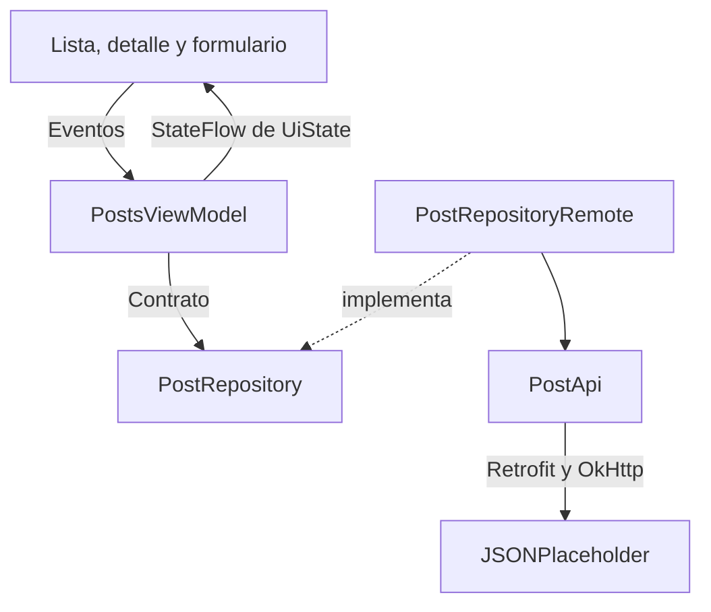
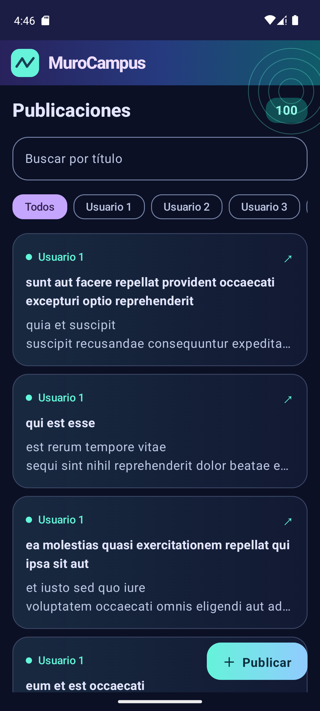

# MuroCampus

**Autor:** Ivan Rodrigo Jara Ayala · TECSUP · Programación en Móviles · Semana 09

Aplicación Android en Kotlin y Jetpack Compose que lee publicaciones de JSONPlaceholder, muestra sus comentarios, filtra por usuario y envía publicaciones nuevas. La pantalla conserva su estado al rotar y permite reintentar cuando una solicitud falla. La base de esta entrega se reconstruyó a partir de la guía porque no se proporcionó el ZIP inicial.

## Ejecutar

Abre la carpeta que contiene `settings.gradle.kts` en Android Studio. Sincroniza Gradle y ejecuta el módulo `app` en un emulador con internet. El proyecto usa JDK 17 o 21 y Android SDK 35. En Windows también puedes compilar con `gradlew.bat :app:assembleDebug`.

## Estructura de paquetes

Bajo `app/src/main/java/com/tecsup/murocampus/`:

```text
MainActivity.kt
model/
  Modelos.kt                 Usuario, Post, Comentario y NuevoPost
data/
  remote/
    PostApi.kt               Rutas, parámetros y cuerpo de la solicitud
    RetrofitClient.kt        Cliente HTTP y conversor JSON
  PostRepository.kt          Contrato, implementación remota y mensajes de error
viewmodel/
  UiState.kt
  PostsViewModel.kt
  PostsViewModelFactory.kt
ui/
  Componentes.kt
  PantallaLista.kt
  PantallaDetalle.kt
  PantallaCrear.kt
  theme/
    Theme.kt
```

El ejemplo de Usuario de la guía está en `app/src/ejemplo/java/com/tecsup/murocampus/ejemplo/EjemploUsuario.kt`. Este directorio se incorpora al módulo al habilitar las dependencias de red.

## Arquitectura MVVM + Repository



La actividad conecta las dependencias. El ViewModel ejecuta las solicitudes en `viewModelScope` y convierte cada `Result` en un estado de pantalla. Compose observa el estado con `collectAsStateWithLifecycle()`. El repositorio propaga la cancelación de las corrutinas.

## Evidencias

| Lista | Detalle y comentarios |
| --- | --- |
|  |  |

| Filtro por usuario | Crear publicación | Error de conexión |
| --- | --- | --- |
|  |  |  |

## Para pensar

1. **¿En qué se diferencian GET, POST, @Body y @Query?** GET consulta un recurso. POST envía datos para crear uno. En `crear`, @Body serializa el título, el contenido y el usuario en JSON. En `porUsuario`, @Query agrega `?userId=2` a la URL para que el servidor filtre los resultados.
2. **¿Por qué usar la ruta «posts»?** Es relativa a la URL base. Con una base que termine en `/api/`, se conservaría ese prefijo. Una ruta que empiece con `/posts` se resolvería desde la raíz del dominio.
3. **¿Por qué devolver Result?** La firma hace explícitos el éxito y el fallo. El ViewModel puede actualizar la pantalla en ambos casos. Los detalles de HTTP y de serialización se manejan en la capa de datos.
4. **¿Qué pasa si se omiten INTERNET o ignoreUnknownKeys?** Android impide abrir las conexiones de red sin el permiso del manifiesto. Con la configuración estricta de JSON, un campo nuevo desconocido puede causar un error de deserialización. Ignorar claves desconocidas permite esa ampliación. Un campo obligatorio ausente sigue produciendo un error.
5. **¿Por qué usar when sobre UiState?** Hay un solo estado vigente y el compilador exige cubrir las variantes de la interfaz sellada. Tres indicadores independientes podrían dejar visibles a la vez la carga y el error.
6. **¿Qué cambiaría con un servicio real?** JSONPlaceholder responde al POST con un ID simulado y la lista posterior conserva sus datos originales. Con una API que persista cambios usaría el ID real devuelto, actualizaría la lista tras el éxito y aplicaría la autenticación y la validación que exija el servidor.

## Fase 2 · mejora-ia

| Mejora | Implementación |
| --- | --- |
| Encabezado de solicitudes | EncabezadoJson agrega Accept application/json a los clientes HTTP |
| Búsqueda local | StateFlow combina la lista descargada y la consulta, ignorando mayúsculas |
| Edición del título | PATCH posts/{id}, Repository con Result y pantalla con respuesta del servidor |
| Diseño | Fondo nocturno, acentos turquesa y violeta, botones degradados y transiciones de entrada |

Se agregaron data/remote/EncabezadoJson.kt y ui/PantallaEditar.kt. CambioTitulo representa el cuerpo del PATCH. El ViewModel depende de PostRepository y la UI observa los StateFlow con collectAsStateWithLifecycle.

JSONPlaceholder simula PATCH. El título devuelto se conserva durante la sesión del ViewModel y se refleja en lista y detalle. Al reiniciar la app se recuperan los datos originales del servicio.

Las pruebas interactivas incluyen búsqueda, encabezado HTTP, edición, rotación, creación y recuperación de conexión. Las capturas de esta rama están en capturas/mejora-ia. El registro de revisión asistida se encuentra en PROMPTS.md.
