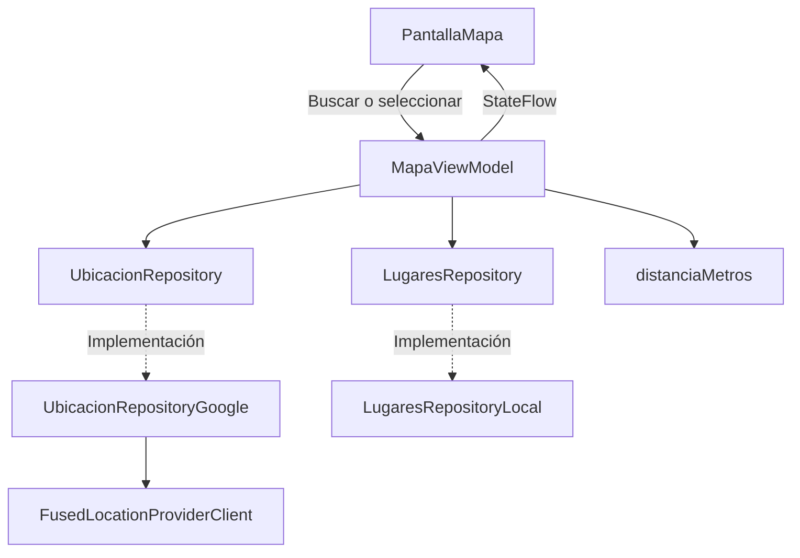
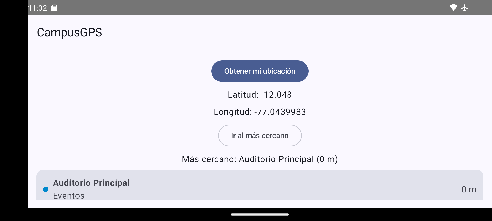
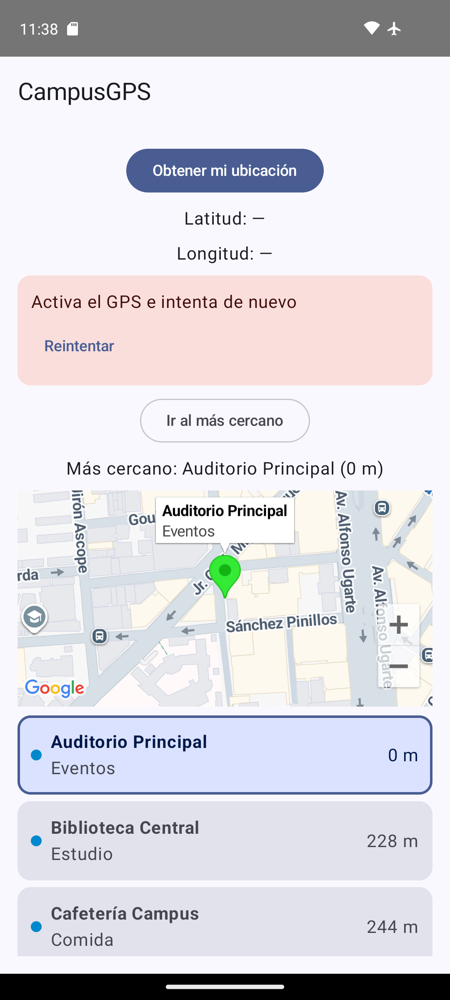
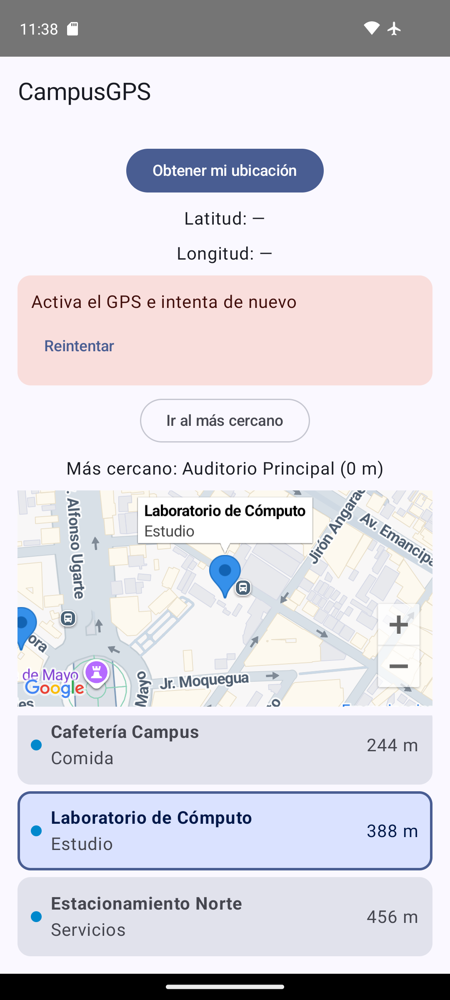

# CampusGPS

**Autor:** Iván Rodrigo Jara Ayala · Programación en Móviles · Laboratorio 13

CampusGPS muestra mi ubicación y cinco lugares ficticios del campus en un mapa. Ordena los lugares por distancia, resalta en verde el más cercano y permite centrar la cámara en una tarjeta seleccionada. Usé Kotlin, Jetpack Compose, Material 3, Maps Compose y Google Play Services Location.

## Estructura del proyecto

```text
app/src/main/java/com/tecsup/campusgps/
├── MainActivity.kt
├── model/
│   └── Modelos.kt
├── data/
│   ├── UbicacionRepository.kt
│   ├── UbicacionRepositoryGoogle.kt
│   ├── LugaresRepository.kt
│   └── LugaresRepositoryLocal.kt
├── util/
│   ├── Distancia.kt
│   └── Formato.kt
├── viewmodel/
│   ├── MapaViewModel.kt
│   └── CampusViewModelFactory.kt
└── ui/
    ├── PantallaMapa.kt
    ├── MapaUbicacion.kt
    ├── ListaLugares.kt
    ├── MensajeError.kt
    └── theme/
        ├── Color.kt
        ├── Theme.kt
        └── Type.kt
```

## Arquitectura MVVM + Repository



Enlazo las implementaciones con el ViewModel mediante CampusViewModelFactory. La pantalla observa el estado para dibujar el mapa, la lista y los errores. Cuando selecciono una tarjeta, el ViewModel conserva el ID y el mapa mueve la cámara.

## Capturas del emulador

### Permiso de ubicación


### Mapa con mi ubicación


### Lugares del campus


### Lista ordenada por distancia


### Permiso denegado


## Para pensar

**1. ¿Por qué puse FusedLocationProviderClient en el Repository?**  
El cliente necesita el contexto de Android y llama a Google Play Services. Encapsulé esa operación en UbicacionRepositoryGoogle. Así, MapaViewModel puede pedir una posición mediante la interfaz y manejar el resultado sin recibir un Context.

**2. ¿Qué diferencia hay entre el permiso y la clave de Maps?**  
El permiso lo concede el usuario para que la app lea su ubicación. Si lo deniega, muestro un mensaje y la opción Abrir ajustes. La clave autoriza al SDK a cargar el mapa. Una clave inválida puede dejar el mapa en gris aunque la app obtenga las coordenadas.

**3. ¿Por qué guardé la clave en local.properties y qué haría si se publicara?**  
Gradle lee la clave de ese archivo local y la pasa al Manifest mediante un placeholder. Git ignora el archivo. Restringí la clave al paquete com.tecsup.campusgps, a la huella SHA-1 y a Maps SDK for Android. Si se subiera, crearía una clave de reemplazo con esas restricciones, actualizaría la configuración, revocaría la expuesta y revisaría el historial y el uso en Google Cloud.

**4. ¿Dónde calculo la distancia y por qué?**  
En Distancia.kt uso Location.distanceBetween. Cuando buscar() recibe una posición, el ViewModel calcula los metros de cada lugar, ordena la lista y publica el resultado. La pantalla puede redibujarse sin repetir esos cálculos.

**5. ¿Qué pasa si el usuario niega el permiso dos veces?**  
Android puede dejar de mostrar el diálogo. Si la solicitud vuelve sin un permiso concedido, el ViewModel publica SIN_PERMISO. Muestro Abrir ajustes para que el usuario pueda conceder el permiso desde la ficha de CampusGPS. Al volver, el botón de ubicación comprueba el permiso otra vez.

## Pruebas de aceptación

- [x] El primer intento muestra el diálogo de permiso.
- [x] Al aceptar se ven latitud, longitud y el marcador propio.
- [x] Al denegar aparece Abrir ajustes y la app continúa abierta.
- [x] Los cinco lugares aparecen cerca del punto base. En la versión final el más cercano se ve en verde.
- [x] Al tocar un marcador se leen el nombre y la categoría.
- [x] Las cinco distancias están ordenadas y usan metros o kilómetros.
- [x] Seleccionar una tarjeta la resalta y mueve la cámara.
- [x] Ir al más cercano está deshabilitado al inicio y luego centra el mapa en el marcador verde.
- [x] Cambiar la ubicación y buscar otra vez actualiza las distancias, el orden y el lugar verde.
- [x] Con la ubicación apagada aparece la acción Reintentar.
- [x] Al rotar se mantienen la ubicación y la lista.
- [x] Revisé que la clave de Maps y local.properties estén fuera de los archivos versionados del proyecto.


## Mejoras de la Fase 2

- **Filtro por categoría.** Mapa y lista observan los mismos lugares filtrados. El marcador verde indica el más cercano entre los visibles. La tarjeta resaltada y el globo indican cuál seleccioné.
- **Radio de cercanía.** Puedo elegir 100, 200 o 500 metros. El mapa muestra el círculo alrededor de mi ubicación y las tarjetas indican qué lugares quedan dentro.
- **Mapa en modo oscuro.** Cuando activo el tema oscuro de Android, CampusGPS aplica el estilo de `res/raw/mapa_nocturno.json` con `MapStyleOptions` y aclara el borde del círculo. Al volver al tema claro se recupera el mapa diurno.

Las decisiones y los prompts que utilicé están en [PROMPTS.md](PROMPTS.md).
