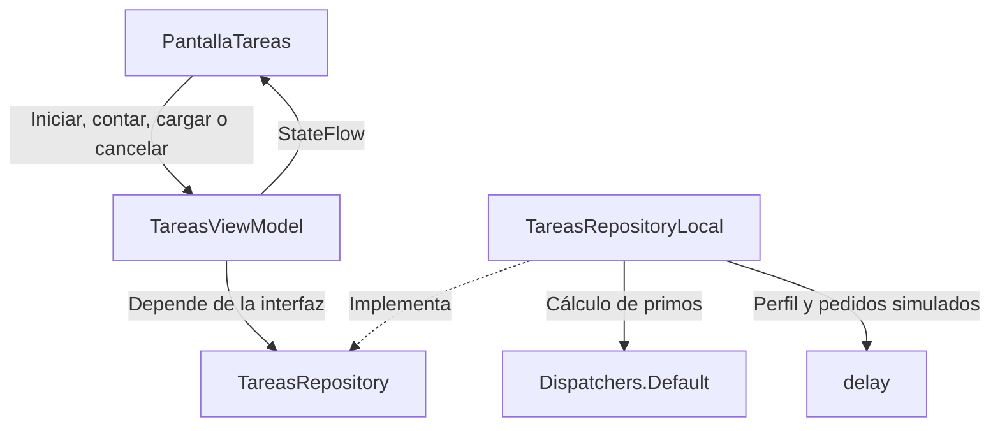
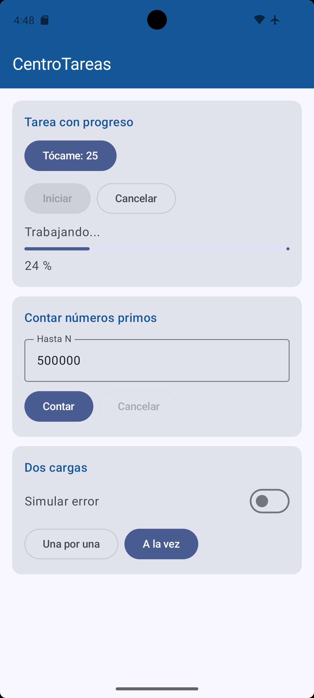
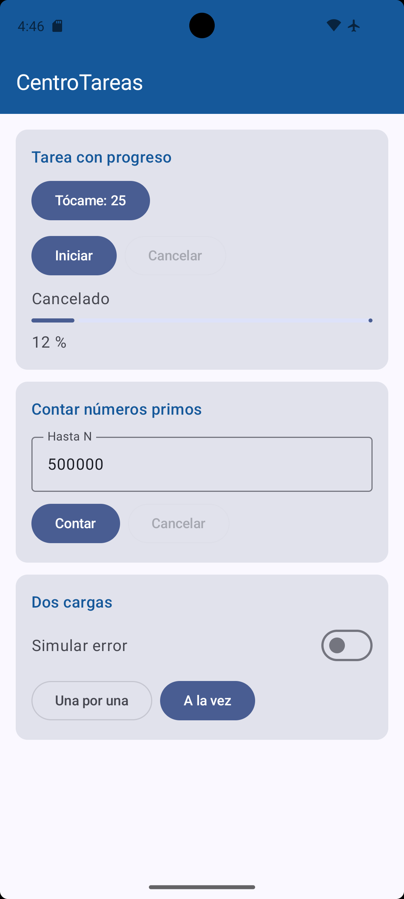
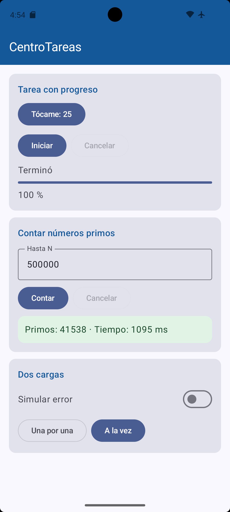
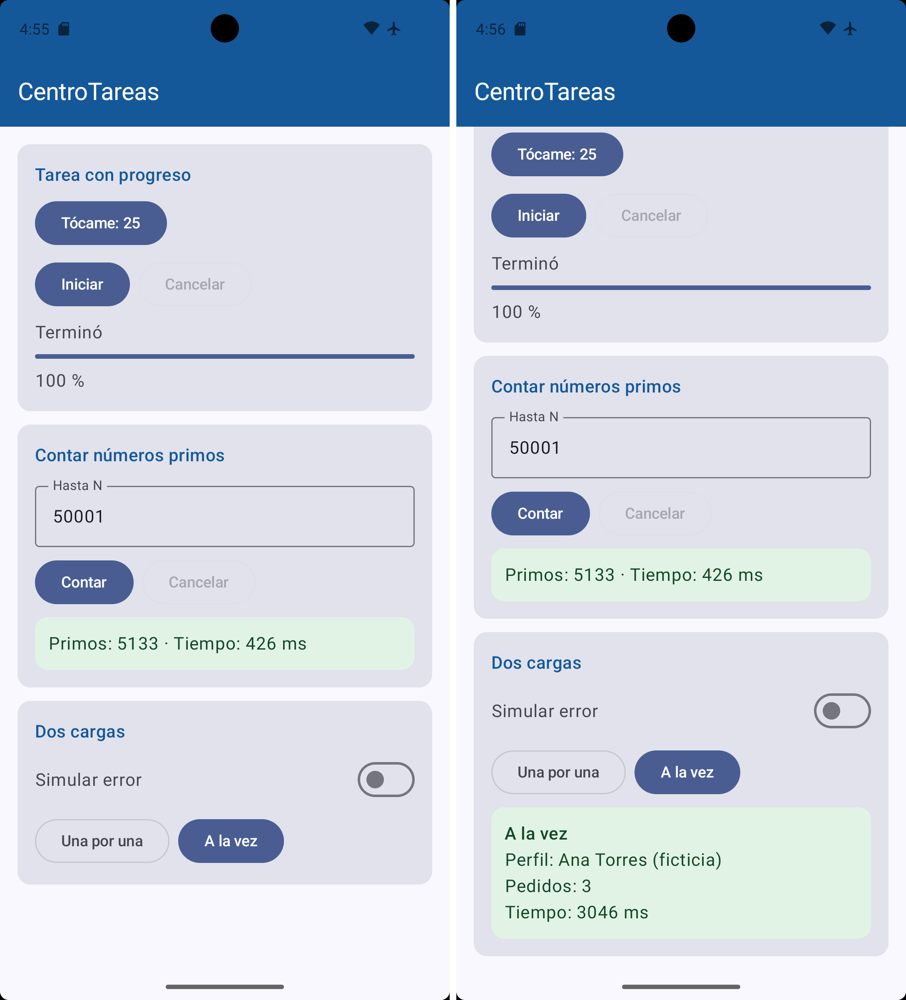
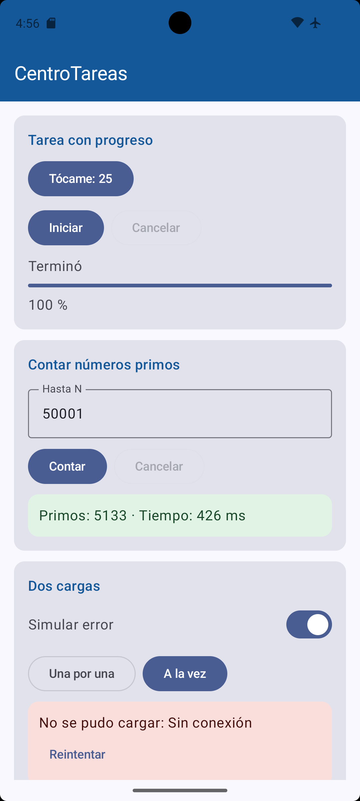

# CentroTareas

## Observación del Paso 1

Pulsé «Tarea larga (MAL)» y enseguida toqué «Tócame». Durante unos cuatro segundos el contador no cambió en pantalla. Al terminar la espera vi «Terminó».

El ViewModel asigna «Trabajando...» y ejecuta Thread.sleep(4000) en el hilo principal. Mientras ese hilo duerme, Android no puede dibujar el mensaje ni atender los toques. Al recuperar el control, Compose ya recibe el estado «Terminó».

Si la espera durara diez segundos y yo intentara interactuar, Android podría mostrar el aviso «La aplicación no responde» (ANR).

## Descripción

CentroTareas muestra cómo mantener la pantalla de Android disponible mientras una tarea avanza, se cuentan números primos o se cargan datos. Implementé la interfaz con Kotlin, Jetpack Compose y Material 3. Los datos del perfil y de los pedidos son ficticios.

## Estructura de paquetes

```text
com.tecsup.centrotareas/
├── MainActivity.kt
├── model/
│   └── Estados.kt
├── data/
│   ├── TareasRepository.kt
│   └── TareasRepositoryLocal.kt
├── viewmodel/
│   ├── TareasViewModel.kt
│   └── TareasViewModelFactory.kt
└── ui/
    ├── PantallaTareas.kt
    └── theme/
        ├── Color.kt
        ├── Theme.kt
        └── Type.kt
```

## Arquitectura MVVM con Repository



Desde MainActivity uso TareasViewModelFactory para entregar el repositorio al ViewModel. La pantalla observa el progreso y los estados de los primos y de las cargas. El ViewModel inicia las corrutinas, conserva sus trabajos y publica los resultados. El repositorio implementa el cálculo y las cargas simuladas.

## Capturas de la Fase 1

**1. Tarea larga**



**2. Tarea cancelada**



**3. Conteo de números primos**



**4. Una por una y A la vez**



**5. Error simulado**



## Para pensar

**1. ¿Por qué no se veía «Trabajando...» en el Paso 1?**  
Cambié el estado y enseguida bloqueé el hilo que redibuja la pantalla. Cuando Android volvió a dibujar, el estado ya decía «Terminó».

**2. ¿Qué diferencia hay entre Thread.sleep y delay?**  
Thread.sleep detiene el hilo que ejecuta la llamada. Si ese hilo atiende la interfaz, tampoco puede responder a mis toques. Con delay suspendo la corrutina durante la espera y el hilo queda disponible. La espera también responde a la cancelación del Job.

**3. ¿Por qué usar Dispatchers.Default para los primos y Dispatchers.IO para la red?**  
Contar primos consume procesador, por eso lo ejecuto en Default. IO sirve para operaciones de entrada y salida bloqueantes, como una llamada de red síncrona. En este laboratorio simulo la espera de red con delay, que ya suspende la corrutina sin bloquear el hilo.

**4. ¿Qué sucede al cerrar la pantalla y qué papel cumple viewModelScope?**  
Al salir definitivamente de la actividad, Android libera su ViewModel y cancela las corrutinas de viewModelScope. El conteo de primos comprueba esa cancelación con ensureActive(). Al rotar, Android conserva el ViewModel de la actividad, así que la tarea continúa y la pantalla vuelve a observar el mismo progreso.

**5. ¿Por qué async tarda unos 3 s y qué pasa si falla una carga?**  
El perfil tarda unos 2 s y los pedidos unos 3 s. Una por una suman unos 5 s. Con async inicio ambas cargas antes de esperar sus resultados y el tiempo total se aproxima al de la más lenta. Si una falla dentro de coroutineScope, se cancela la otra si sigue activa y el error llega al ViewModel. La pantalla muestra Reintentar para volver a cargar en paralelo.

## Pruebas de aceptación

- [x] Tócame siguió sumando mientras la tarea estaba en ejecución.
- [x] En Logcat observé main antes y después, y DefaultDispatcher-worker dentro del cambio de contexto.
- [x] La barra avanzó de 0 a 100 % en unos cuatro segundos.
- [x] Al cancelar, el porcentaje se detuvo y pude iniciar de nuevo.
- [x] Un segundo toque en Iniciar no lanzó otra tarea.
- [x] Para N = 1000 obtuve 168 primos.
- [x] Con N grande la pantalla respondió y pude cancelar el cálculo.
- [x] Una por una devolvió el perfil y tres pedidos en unos cinco segundos.
- [x] A la vez devolvió el mismo resultado en unos tres segundos.
- [x] El error apareció en rojo y, al desactivar el interruptor y reintentar, obtuve el resultado en verde.
- [x] Al rotar, la tarea continuó y conservó el progreso.
- [x] Revisé el código final con git grep y no aparecieron las tres llamadas prohibidas por la guía.
