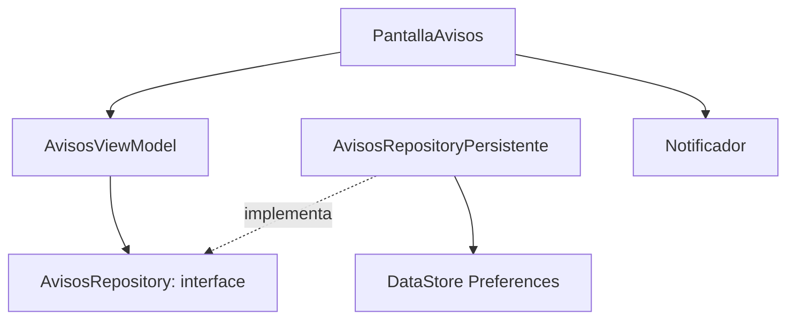
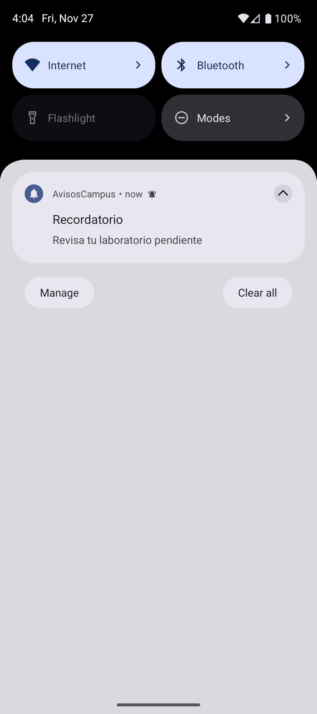
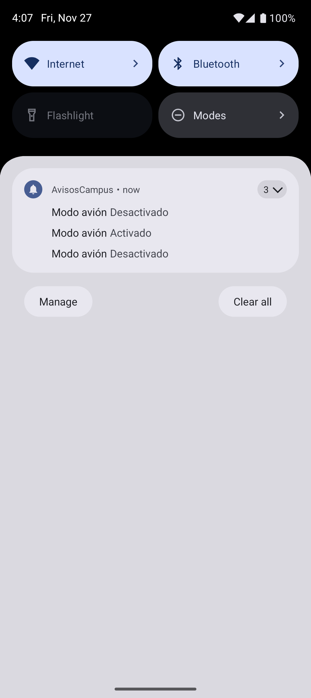
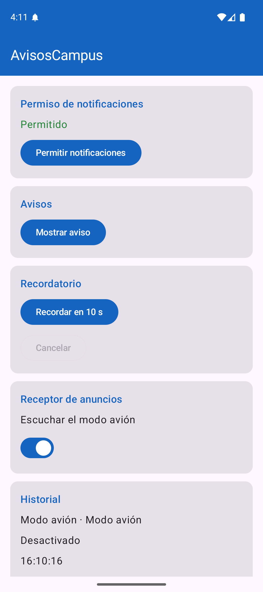

# AvisosCampus

Aplicación Android de notificaciones locales, recordatorios y eventos del sistema.

| Dato | Información |
|---|---|
| Estudiante | IVAN RODRIGO JARA AYALA |
| Institución | TECSUP |
| Carrera | Diseño y Desarrollo de Software |
| Curso | Programación en Móviles |
| Docente | Juan José León Suiyon |
| Laboratorio | Semana 15 — Notificaciones en Android |
| Package | `com.tecsup.avisoscampus` |
| Tecnologías | Kotlin, Jetpack Compose, Material 3 y DataStore Preferences |
| Arquitectura | MVVM + Repository mediante interface |

## Repositorio y ramas

- [Repositorio](https://github.com/JARA20022/Programacion_Moviles_Jara)
- [Fase 1: main](https://github.com/JARA20022/Programacion_Moviles_Jara/tree/main/Semana15/AvisosCampus)
- [Fase 2: mejora-ia](https://github.com/JARA20022/Programacion_Moviles_Jara/tree/mejora-ia/Semana15/AvisosCampus)

El proyecto Android está dentro de `Semana15/AvisosCampus`. Este README describe la versión preparada para `mejora-ia` y conserva las referencias a las evidencias de main.

## Descripción

AvisosCampus permite mostrar avisos, programar un recordatorio de diez segundos y escuchar cambios del modo avión. Cada aviso se registra en un historial. La aplicación maneja el permiso de notificaciones y permite abrir los ajustes cuando el usuario lo deniega.

La fase main desarrolla las funciones base. La fase mejora-ia incorpora almacenamiento persistente, un canal urgente para recordatorios, notificaciones expandibles y un rediseño adaptable.

## Funcionalidades

- Solicitud de POST_NOTIFICATIONS en Android 13 o superior.
- Estados Sin pedir, Permitido y Denegado.
- Botón Mostrar aviso con identificadores distintos.
- Apertura de la app al tocar una notificación y retirada automática de esa notificación.
- Recordatorio de diez segundos con cuenta regresiva y cancelación.
- Switch para escuchar la activación y desactivación del modo avión.
- Historial con origen, título, mensaje y hora, ordenado del más reciente al más antiguo.
- Manejo del permiso denegado sin cierre de la aplicación.

## Mejoras seleccionadas del GLAB

| Mejora | Implementación preparada | Capas involucradas |
|---|---|---|
| Historial persistente | DataStore Preferences conserva los avisos al cerrar y abrir la app. Incluye borrado con confirmación. | Repository, ViewModel, UI y composición de dependencias. |
| Dos canales | Avisos con IMPORTANCE_DEFAULT y Urgentes con IMPORTANCE_HIGH. Los recordatorios utilizan Urgentes. | Notificador y origen de los eventos emitidos por ViewModel. |
| Texto largo | BigTextStyle permite expandir el contenido de la notificación. | Notificador. |

Además, el historial permite filtrar por origen. Se conservan hasta 200 registros y se muestran los 20 más recientes del filtro elegido.

## Diseño de mejora-ia

La interfaz utiliza un encabezado con degradado, paneles redondeados, acentos de color por función y un indicador circular para la cuenta regresiva. Incluye transiciones de tamaño y visibilidad.

| Uso | Color |
|---|---|
| Fondo | `#0C1020` |
| Paneles | `#181E33` |
| Texto principal | `#F3F4FF` |
| Texto secundario | `#A9B3CF` |
| Primario violeta | `#B5A5FF` |
| Acento menta | `#69E2C4` |
| Acento ámbar | `#FFCA80` |
| Error | `#FFA5AC` |
| Degradado del encabezado | `#45307C` → `#24345D` → `#153C43` |

En ventanas estrechas los controles y el historial se presentan en una columna. Desde aproximadamente 700 dp disponibles se distribuyen en dos columnas. La orientación no está bloqueada: puede utilizarse en vertical y horizontal. Los filtros se conservan con rememberSaveable y la cuenta regresiva permanece en el ViewModel.

## Estructura de paquetes

```text
com.tecsup.avisoscampus/
├── MainActivity.kt
├── AvisosApp.kt
├── model/
│   └── Modelos.kt
├── data/
│   └── AvisosRepository.kt
├── viewmodel/
│   └── AvisosViewModel.kt
├── notificacion/
│   └── Notificador.kt
├── receiver/
│   └── ModoAvionReceiver.kt
└── ui/
    ├── CampusTheme.kt
    ├── PantallaAvisos.kt
    ├── HistorialAvisos.kt
    └── theme/  (archivos conservados del proyecto base)
```

## Arquitectura MVVM + Repository



- **View:** representa el estado, solicita permisos y recoge eventos para llamar al Notificador.
- **ViewModel:** coordina avisos, recordatorios, escucha y borrado del historial. No recibe Context ni usa NotificationManager.
- **Repository:** registra y conserva avisos. Recibe DataStore como dependencia y no usa Context.
- **Notificador:** interactúa con Android, crea canales y construye notificaciones.
- **Receiver:** entrega el cambio del modo avión sin hacer trabajo largo.
- **Application:** crea los canales y proporciona una sola instancia de almacenamiento y Repository.

El receptor se registra con RECEIVER_NOT_EXPORTED y se desregistra en onDispose. El PendingIntent utiliza FLAG_IMMUTABLE.

## Ejecución

1. Abrir `Semana15/AvisosCampus` en Android Studio.
2. Sincronizar Gradle y esperar la descarga inicial de dependencias.
3. Encender un emulador Android 13 o superior para probar el permiso de notificaciones.
4. Ejecutar la aplicación con Run.
5. Conceder el permiso y probar los controles.

Para compilar desde la carpeta del proyecto:

```bash
bash ./gradlew :app:assembleDebug
```

La app funciona localmente, sin claves de API ni conexión a internet para sus funciones. La descarga de dependencias durante la primera compilación sí requiere conexión.

## Evidencias de la fase main

Estas imágenes corresponden a las capturas de la fase base guardadas en `capturas/`; no representan el diseño nuevo de mejora-ia.

### Notificación en el panel


### Recordatorio con cuenta regresiva



### Modo avión



### Historial



### Permiso denegado


Las nuevas capturas de mejora-ia pueden añadirse después de probar la app. El script no obliga a capturarlas.

## Pruebas de aceptación

Esta lista sirve para verificar la versión final de mejora-ia. Marcar cada prueba después de ejecutarla; la compilación por sí sola no acredita estos comportamientos.

- [ ] Existe el canal Avisos.
- [ ] Se solicita el permiso y cambia la etiqueta de estado.
- [ ] Mostrar aviso crea la notificación Tarea lista.
- [ ] Dos avisos consecutivos aparecen como notificaciones distintas.
- [ ] Tocar una notificación abre la app y la retira del panel.
- [ ] El recordatorio cuenta diez segundos y después notifica.
- [ ] Minimizar mantiene la cuenta mientras el proceso permanece vivo.
- [ ] Cancelar evita que llegue el recordatorio.
- [ ] Con el switch activo se notifican ambos cambios del modo avión.
- [ ] Con el switch apagado no se registran cambios del modo avión.
- [ ] Con permiso denegado el aviso se guarda, aparece un mensaje y no se cierra la app.
- [ ] La cuenta y el historial se conservan al rotar.
- [ ] No hay Context ni NotificationManager en el ViewModel.
- [ ] El receptor se quita en onDispose.
- [ ] Los nuevos avisos permanecen después de cerrar el proceso y volver a abrir.
- [ ] Existen Avisos y Urgentes; los recordatorios utilizan Urgentes.
- [ ] Al expandir una notificación aparece el texto completo.
- [ ] Los filtros y el borrado con confirmación funcionan.
- [ ] Vertical y horizontal muestran contenido legible y controles accesibles.

## Para pensar

### ¿Por qué una notificación necesita canal y permiso? ¿Qué pasa si falta cada uno?

Desde Android 8, el canal organiza las notificaciones y permite al usuario configurar su comportamiento. Si falta el canal requerido, la notificación no se muestra. Desde Android 13 se necesita autorización POST_NOTIFICATIONS para estas notificaciones. Si se deniega, la app conserva el aviso en el historial y muestra un mensaje en pantalla.

### ¿Por qué el ViewModel emite un evento y no muestra la notificación él mismo?

Porque decide qué ocurre en la aplicación sin depender de Context ni de NotificationManager. La pantalla recoge el evento y delega la interacción con Android en el Notificador. Así se mantiene la separación de responsabilidades.

### ¿Qué pasa si usas el mismo id en dos notificaciones?

Cuando coinciden el id y el tag, la segunda actualiza o sustituye a la primera. Para mostrar varios avisos se utilizan identificadores distintos. En la fase persistente también se guarda la secuencia de identificadores.

### ¿Por qué onReceive debe ser corto y por qué hay que quitar el receptor al salir?

onReceive no debe bloquear el hilo principal con trabajo largo. El receptor comunica el cambio y el resto se gestiona en las capas correspondientes. Desregistrarlo en onDispose evita mantener registros y referencias de una pantalla que ya no los necesita.

### ¿En qué casos usarías una notificación local y en cuáles una push de Firebase?

Una local sirve para un recordatorio generado en el teléfono o un evento del sistema. Una push sirve para un aviso enviado desde un servidor, como un mensaje o una novedad compartida. Este proyecto implementa notificaciones locales.

## Alcance y límites

El historial de main estaba en memoria. DataStore guarda los nuevos avisos de mejora-ia, pero no recupera los que ya se perdieron al finalizar el proceso de la fase anterior.

La corrutina del recordatorio no sustituye una alarma del sistema: se conserva al rotar o minimizar mientras el proceso sigue vivo, pero no garantiza ejecución tras matar el proceso ni reiniciar el teléfono. La aparición emergente del canal Urgentes depende también de las preferencias de Android y de No molestar.

## Trabajo con IA

La preparación inicial del código y de estos documentos contó con asistencia de ChatGPT. [PROMPTS.md](PROMPTS.md) contiene un prompt detallado para solicitar a Gemini en Android Studio el rediseño o su revisión, con paleta, distribución adaptable, animaciones y restricciones del GLAB. Incluye la tabla para registrar la respuesta real, lo aceptado o descartado y su justificación.

## Entrega

El GLAB solicita las ramas main y mejora-ia, un mínimo de diez commits en main y tres en mejora-ia, README con estructura, diagrama, cinco capturas y respuestas, además del registro de prompts de Gemini. Revisar el historial y completar el registro real de Gemini antes de entregar.
