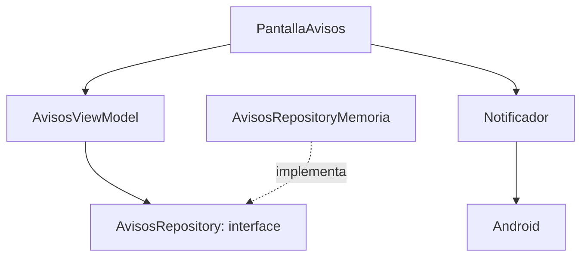
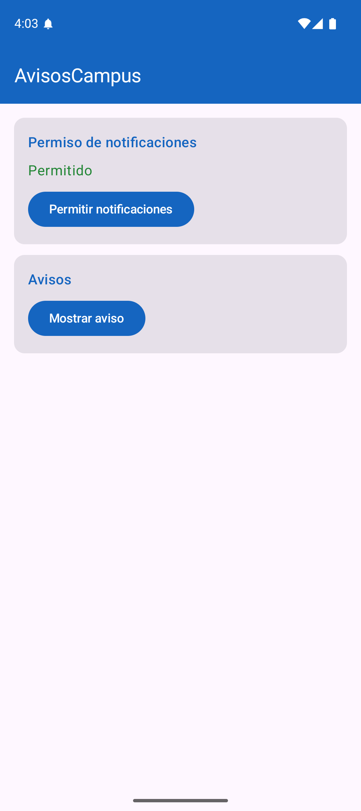
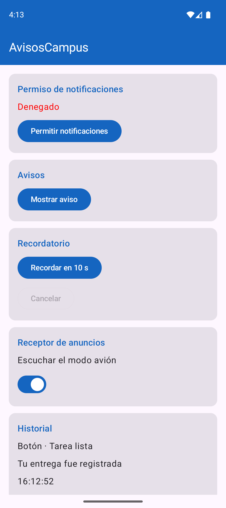
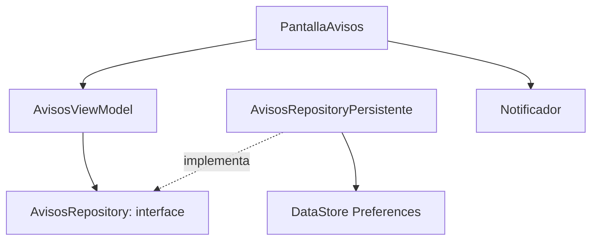

# AvisosCampus — Semana 15

Autor: IVAN RODRIGO JARA AYALA. Programación en Móviles, TECSUP.

Aplicación local con Kotlin, Jetpack Compose y Material 3. Muestra avisos, programa un recordatorio de 10 segundos y escucha cambios del modo avión. El historial queda en memoria y se conserva al rotar; se pierde al terminar el proceso.

## Ejecución

Abrir esta carpeta en Android Studio, sincronizar Gradle y ejecutar en Android 13 o superior para probar POST_NOTIFICATIONS. No necesita internet ni claves para funcionar. La primera compilación sí puede descargar dependencias.

## Estructura

```text
com.tecsup.avisoscampus
  MainActivity.kt
  AvisosApp.kt
  model/Modelos.kt
  data/AvisosRepository.kt
  viewmodel/AvisosViewModel.kt
  notificacion/Notificador.kt
  receiver/ModoAvionReceiver.kt
  ui/PantallaAvisos.kt
  ui/HistorialAvisos.kt
```

## MVVM + Repository



El ViewModel registra avisos y emite eventos. La pantalla recoge los eventos y llama al Notificador. Solo las clases que interactúan con Android usan Context. El receptor únicamente entrega el cambio del modo avión al ViewModel, y se desregistra en onDispose.

## Evidencias

### Notificación en el panel



### Recordatorio con cuenta regresiva


### Cambio del modo avión


### Historial de avisos


### Permiso denegado



## Para pensar

1. **Canal y permiso:** desde Android 8 se requiere un canal; si falta, la notificación no se muestra. Desde Android 13 se requiere la autorización POST_NOTIFICATIONS. Si se deniega, esta app guarda el aviso en el historial sin mostrarlo en el panel.
2. **Eventos del ViewModel:** separan la lógica de la app del sistema Android. El ViewModel no necesita Context ni NotificationManager y se puede probar de forma independiente.
3. **Mismo id:** una notificación con el mismo id y tag actualiza o sustituye la anterior. Se usan identificadores distintos para conservar varias notificaciones.
4. **onReceive corto y desregistro:** el receptor no debe bloquear el hilo principal; un trabajo largo puede provocar que la app no responda. Al salir de la composición se quita el receptor para evitar registros duplicados y referencias que ya no se necesitan.
5. **Local o push:** una notificación local sirve para un recordatorio generado en el teléfono o un cambio del sistema. Una push de Firebase sirve para avisos que llegan desde un servidor, como un mensaje o una novedad compartida.

## Alcance

El recordatorio usa viewModelScope: continúa al minimizar y al rotar, mientras el proceso sigue vivo. No garantiza ejecución después de matar el proceso ni tras reiniciar el teléfono. El historial de esta fase no es persistente.

## Registro del trabajo

Implementación asistida por IA y revisión manual por etapas. Las capturas corresponden al emulador utilizado durante la ejecución. Esta entrega cubre Fase 1, rama main; la Fase 2 del GLAB se desarrolla después en mejora-ia.

## Pruebas de aceptación

- [x] Existe el canal Avisos (verificado por el estudiante durante la ejecución).
- [x] Se solicita el permiso y cambia la etiqueta (verificado por el estudiante durante la ejecución).
- [x] Mostrar aviso crea Tarea lista (verificado por el estudiante durante la ejecución).
- [x] Dos avisos tienen ids diferentes (verificado por el estudiante durante la ejecución).
- [x] Tocar abre la app y retira la notificación (verificado por el estudiante durante la ejecución).
- [x] Cuenta regresiva finaliza con un aviso (verificado por el estudiante durante la ejecución).
- [x] Recordatorio funciona al minimizar (verificado por el estudiante durante la ejecución).
- [x] Cancelar evita el aviso (verificado por el estudiante durante la ejecución).
- [x] Switch activo recibe activado y desactivado (verificado por el estudiante durante la ejecución).
- [x] Switch apagado no registra avisos de modo avión (verificado por el estudiante durante la ejecución).
- [x] Permiso denegado conserva historial y muestra error sin cierre (verificado por el estudiante durante la ejecución).
- [x] Rotación conserva cuenta e historial (verificado por el estudiante durante la ejecución).
- [x] No hay Context en ViewModel y el receptor se quita en onDispose (verificado por el estudiante durante la ejecución).

<!-- AVISOSCAMPUS_MEJORA -->
## Fase 2 — mejora-ia

Esta sección describe la versión actual de la rama mejora-ia. Las secciones anteriores y sus capturas documentan la fase main.

### Mejoras elegidas del GLAB

| Mejora solicitada | Implementación | Capas modificadas |
|---|---|---|
| Historial persistente | DataStore Preferences conserva hasta 200 avisos; muestra 20 del filtro elegido. Permite borrar con confirmación. | Repository, ViewModel y UI; Application crea la dependencia. |
| Dos canales | Avisos con IMPORTANCE_DEFAULT; Urgentes con IMPORTANCE_HIGH para recordatorios. | Notificador; el ViewModel emite avisos con origen RECORDATORIO. |
| Texto largo | BigTextStyle permite expandir el texto completo en el panel de notificaciones. | Notificador. |

### Diseño y adaptación

Tema oscuro azul noche, gradientes violeta/turquesa, acentos menta y ámbar, tarjetas redondeadas, contador circular animado y transiciones de visibilidad/tamaño. La pantalla usa una columna en ventanas estrechas y dos a partir de 700 dp disponibles. No bloquea la orientación: admite vertical y horizontal, desplazamiento y áreas seguras del sistema.

Los filtros y el diálogo conservan su estado con rememberSaveable. El ViewModel conserva la cuenta y el switch al rotar. El Repository persiste el historial al cerrar el proceso; el temporizador sigue siendo una corrutina y no se garantiza tras matar el proceso o reiniciar el teléfono.

### Arquitectura



El ViewModel y el Repository no reciben Context. AvisosApp crea una sola instancia de DataStore y suministra el Repository. El receptor se registra con RECEIVER_NOT_EXPORTED y se desregistra en onDispose. Los PendingIntent usan FLAG_IMMUTABLE. El ViewModel registra el aviso antes de emitir el evento para notificar. DataStore serializa las actualizaciones; el identificador siguiente se guarda junto al historial.

### Archivos principales de mejora-ia

- `AvisosApp.kt`: composición de dependencias y canales.
- `MainActivity.kt`: ViewModelProvider y tema.
- `data/AvisosRepository.kt`: interface y almacenamiento DataStore.
- `viewmodel/AvisosViewModel.kt`: estado, corrutina, eventos, borrado y manejo de errores.
- `notificacion/Notificador.kt`: permiso, canales, BigTextStyle y PendingIntent.
- `receiver/ModoAvionReceiver.kt`: receptor del sistema conservado de main.
- `ui/CampusTheme.kt`: paleta nueva.
- `ui/PantallaAvisos.kt`: diseño adaptable, animaciones y controles.
- `ui/HistorialAvisos.kt`: historial con etiquetas de origen y fecha/hora.

### Comprobaciones de la fase 2

El script compila antes de cada commit. La compilación no sustituye estas pruebas manuales; marca las casillas después de realizarlas:

- [ ] Generar avisos, cerrar el proceso y volver a abrir: el historial permanece.
- [ ] Girar durante el recordatorio: la cuenta continúa.
- [ ] Minimizar durante el recordatorio: llega el aviso mientras el proceso sigue vivo.
- [ ] Cancelar: no llega el recordatorio.
- [ ] Consultar Avisos y Urgentes en Ajustes.
- [ ] Recordatorio utiliza Urgentes; aviso del botón utiliza Avisos.
- [ ] Expandir una notificación: aparece el texto completo.
- [ ] Tocar la notificación: abre la app y desaparece del panel.
- [ ] Switch activo: modo avión genera avisos; apagado: no genera avisos.
- [ ] Permiso denegado: guarda el aviso y muestra mensaje, sin cierre inesperado.
- [ ] Conceder permiso desde Ajustes y volver: actualiza el estado.
- [ ] Filtrar el historial y borrar con confirmación.
- [ ] Probar vertical y horizontal sin botones cortados.

La aparición de un aviso emergente depende también de los ajustes de Android y del usuario, como No molestar y la configuración del canal. Las capturas de main se conservan; las nuevas capturas de mejora-ia son opcionales en el script y no se generan ni se inventan.

### Asistencia con IA

Implementación preparada con ChatGPT. El GLAB solicita una intervención real con Gemini en Android Studio: `PROMPTS.md` incluye un prompt para esa revisión y campos que deben completarse con la respuesta real.

### Referencias

- [DataStore](https://developer.android.com/topic/libraries/architecture/datastore)
- [Diseños Compose](https://developer.android.com/develop/ui/compose/layouts/basics)
- [Notificaciones](https://developer.android.com/develop/ui/views/notifications)
